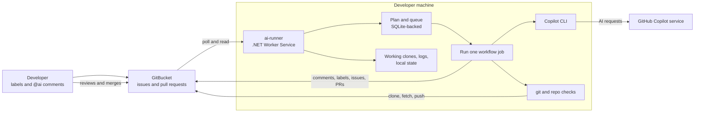
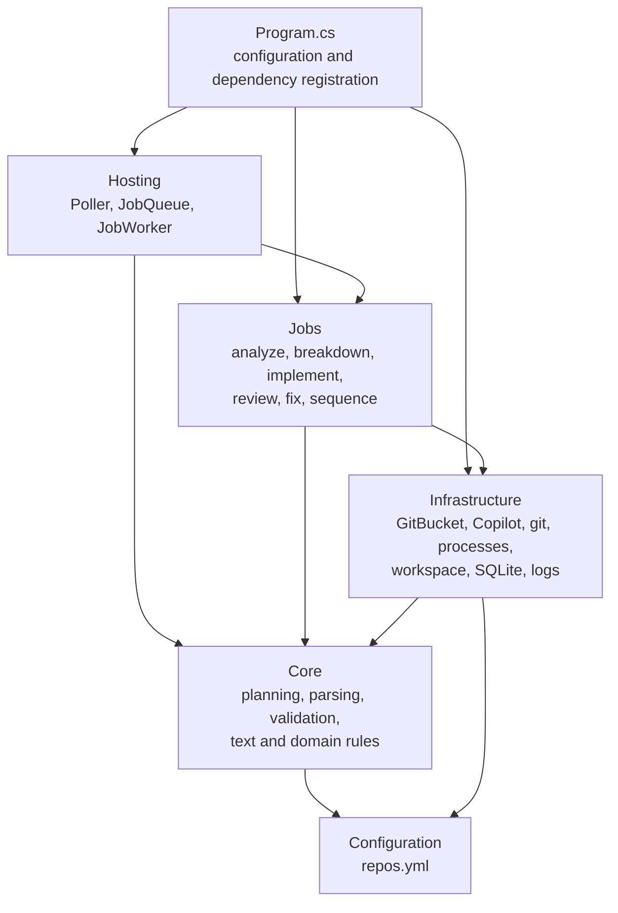

# ai-workflow

`ai-workflow` is a local automation service for using GitHub Copilot CLI with GitBucket issues and pull requests. Its worker, `ai-runner`, runs on a developer's machine, polls GitBucket, and starts the appropriate AI-assisted workflow. It can analyze and break down issues, implement approved work, review pull requests, and apply requested review fixes.

The runner exists to connect GitBucket to a Copilot CLI session on a developer's computer. GitBucket does not need to call into the machine: the runner pulls work from GitBucket, uses a local clone of each configured repository, then posts results and branches back. **A person reviews and merges every pull request; the runner never merges.**

## At A Glance



The recurring path is **Poll -> Plan -> Queue -> Job**. Each job re-reads the latest issue or pull request and checks the plan again before acting, so stale or duplicate queued work is harmless.

## Workflows

Workflows are enabled per repository in `repos.yml`. The runner only considers configured repositories.

| Workflow | How it starts | What it does |
| --- | --- | --- |
| Analyze | Put the `ai` label on an issue. Follow-up analysis requires a new `@ai` comment. | Copilot asks questions, records assumptions and a plan, and classifies the work. When ready, it produces a SPEC. |
| Break down | Add `ai-breakdown` to an issue marked `ai:ready` and `ai:complex`. | Creates a feature branch and sub-issues. The runner can sequence the sub-issues and open a final PR when they are complete. |
| Implement | Add `ai-implement` to an issue marked `ai:ready` and `ai:simple`. | Copilot changes code in a local clone. The runner verifies configured build, test, lint, and PR-description checks, then pushes a branch and opens a PR. |
| Review | A new commit on an in-scope pull request. By default, scope is pull requests labelled `ai` and those opened by this runner. | Copilot posts or updates a review comment. Draft PRs and PRs titled `[skip-ai]...` are skipped. |
| Review fix | Add `@ai` to a comment on an in-scope pull request. | Copilot applies the requested fixes. The runner pushes to the PR branch only when configured build, test, or lint checks pass; otherwise it saves the work on a separate branch. |

Analysis and review are read-only. Implementation and review fixes can change code, but all resulting changes still require human review. The `needs-cloud-agent` and `ai:on-github` labels currently tell the planner to skip an issue; the GitHub fallback workflow is **not implemented**.

## Getting Started

### Requirements

- .NET 10 SDK
- `git` on `PATH`
- GitHub Copilot CLI installed and signed in
- Network/VPN access to the configured GitBucket server
- A GitBucket account and API token

Add the token to .NET user secrets; do not put credentials in `repos.yml`:

```powershell
dotnet user-secrets set GitBucket:Token <token> --project src/AiRunner
```

Configure `git_bucket.base_url` and at least one project in [`repos.yml`](repos.yml). All keys are snake_case; an unknown or misspelled key stops the start with a hint. A **project** groups **components** (a repo plus an optional folder `path`): every job checks out all components so the agent sees the whole project, but code is changed in one component only. Issues and sub-issues live in the project's `issues_in` component. Settings in `defaults:` apply to every project, and a project overrides only the keys it names (objects merge key by key, lists replace). For implementation and review fixes, configure each code component's setup/build/test/lint `commands`; they are stack-agnostic and run in the component folder (`run_in: repo` runs them at the clone root; the sample `repos.yml` lints its frontend with a type check plus a formatting check, and a real ESLint setup would be the better lint once the repo has one). The old flat `repos:` list still works: each entry becomes a project with one component.

Each component lists the files that hold the rules for the agent in `instructions` (paths relative to the component folder, default `[AGENTS.md]`; no `..`, no absolute path). They are the **instructions** of the repository, not part of the runner:

```yaml
frontend:
  repo: org/shop-frontend
  instructions: [AGENTS.md, docs/design-system.md]   # each file costs context on every job of this component
```

### How the rules reach the agent

Copilot loads `AGENTS.md` from the folder it starts in, and the runner starts it in the project folder, which is not a clone. So before every job the runner writes `work/<project>/AGENTS.md`: the project description (`PROJECT.md`), the instruction files of the component(s) the job works on copied as they are, and the first instruction file of every other component (the rest only as a path to open). Copilot loads it by itself, the prompt of every job also tells the agent to follow it, and the `code-reviewer` subagent sees it too. A listed file that does not exist is shown as missing; that is not an error. The file is deleted before the next job and is never committed. Keep each repository's instruction file short and concrete: nobody answers the agent while it works, so "ask if unsure" rules do not work; the agent writes its questions under *Open points* in `PR_BODY.md` instead.

### Project layouts

The same rules work for every layout, because every decision goes through `component.repo` and `component.path`. Issues and sub-issues always go to the `issues_in` component; **issues filed anywhere else are ignored**. PRs are polled in every repo that holds a `code: true` component.

**Multi-repo** (a backend and a frontend repo; issues live in one of them):

```yaml
projects:
  shop:
    issues_in: backend
    components:
      backend:  { repo: org/shop-backend,  path: ., commands: { build: "dotnet build", test: "dotnet test" } }
      frontend: { repo: org/shop-frontend, path: ., commands: { setup: "npm ci", build: "npm run build", test: "npm test" } }
```

**Separate issues repo** (a `code: false` component holds issues and docs; it is never changed and never gets a PR):

```yaml
projects:
  shop:
    issues_in: issues
    components:
      issues:   { repo: org/shop-issues,   path: ., code: false }
      backend:  { repo: org/shop-backend,  path: ., commands: { build: "dotnet build", test: "dotnet test" } }
      frontend: { repo: org/shop-frontend, path: ., commands: { setup: "npm ci", build: "npm run build", test: "npm test" } }
```

**Monorepo** (components share one repo and one clone, each with its own folder; a `code: true` path may not overlap another):

```yaml
projects:
  shop:
    issues_in: api
    commands: { run_in: repo, build: "npx nx build", test: "npx nx test" }   # project-level fallback for all components
    components:
      api: { repo: org/shop, path: apps/api }
      web: { repo: org/shop, path: apps/web, commands: { build: "npm run build --workspace web" } }
```

Put a short `PROJECT.md` (default name, set with `context:`) in the `issues_in` component; the agent reads it first. A template is in [`onboarding/PROJECT.md`](onboarding/PROJECT.md). It is copied into `AGENTS.md` of the project folder (see above).

### Settings levels

| Level | Keys |
| --- | --- |
| Global only | `git_bucket`, `poll_interval_seconds`, `runner_name`, `copilot`, `paths`, `log_retention_days`, `attachments`, `git`, `dashboard` |
| `defaults:`, overridable per project | `trigger_label`, `trigger_keyword`, `workflows`, `models`, `limits`, `implement`, `review`, `never_edit`, `auto_start_first_sub_issue`, `claim_enabled` |
| Per component | `repo`, `path`, `code` (default true), `commands` |

`commands` is never in `defaults` (a global command would assume a stack). A component's `commands` override the project's key by key. Objects merge key by key; lists replace the default list. Limits, models and `never_edit` are per project, not per component.

### Dashboard

A local, read-only status page of this runner (health strip now; jobs, issues and cost come next). Off by default:

```yaml
dashboard:
  enabled: true
  port: 5180      # http://localhost:5180/, listens on 127.0.0.1 only
```

Build the UI once with `./build-dashboard.ps1` (needs Node, see `src/AiRunner.Dashboard/package.json`), then start the
runner in its normal loop. `--once`, `--dry-run` and the other modes never start it. If the port is taken the runner logs
one warning and keeps working without the dashboard.

### Several runners (claims)

Set `claim_enabled: true` (in `defaults:` or in one project) to let several runners work on the same projects. Give each runner its own global `runner_name` (empty = the machine user name) and run `--setup-labels` once, so `ai:claimed` exists.

- Before a job runs, the runner puts `ai:claimed` on the issue or PR and keeps **one** claim comment (`Claimed by <runner_name>`) that it edits in place. Another runner that sees a fresh claim skips the item without a trace.
- If two runners write at once, the oldest claim comment wins; the other one edits its comment to "withdrawn" and backs off. Comments are never deleted.
- The claim also names the deadline of its job (the job timeout). Once that deadline and at least 30 minutes have passed, any runner takes the claim over, so a crashed runner never blocks an item, whatever comments the job wrote before it died. A claim without a deadline (older runner version) is taken over after 30 minutes when no bot comment follows it.
- When the job ends (success or failure) the label is removed and the comment says "released". The routine checks (closing after a merge) claim only just before they write.

The claim is the `runner_name` in the comment, not the GitBucket account, so runners may share one token. The race handling narrows the window but cannot close it (GitBucket has no atomic compare-and-set); a job re-plans on fresh data, so a rare double run does no harm beyond the cost.

### Migrating from the old `repos.yml`

1. Rename every key to snake_case (`pollIntervalSeconds` -> `poll_interval_seconds`, `maxDiffLines` -> `max_diff_lines`, `scopeLabel` -> `trigger_label`, ...). An unknown key stops the start and the message suggests the new name; there is no camelCase support.
2. Optional: move shared values into `defaults:` and describe your repos as `projects:`. The old flat `repos:` list still works (each entry becomes a one-component project named after the repo), and both forms may be in one file.
3. Run `dotnet run --project src/AiRunner -- --setup-labels`: it creates the labels in every repo of every project, including `code: false` repos.
4. Delete the old `work/<owner>/` clones. Clones are now under `work/<project>/<repo>/`.
5. Move open issues to the `issues_in` repo (or finish them first). Issues in other repos of a project are no longer polled.
6. Add a `PROJECT.md` to the issues repo (optional, but it saves the agent from guessing).
7. Run `--once --dry-run` and check the planned jobs before the first real run.

Copilot now starts in `work/<project>/`, which is not a git repo. A product repo's own `.github/agents/` files no longer replace the runner's agents. Update the Copilot CLI (`copilot update`) and try one cheap `copilot -p` in an empty non-git folder before the first real run.

### Run

Run these commands from the repository root:

```powershell
# Build and test
dotnet build ai-workflow.slnx
dotnet test ai-workflow.slnx

# Create workflow labels in configured repositories
dotnet run --project src/AiRunner -- --setup-labels

# Poll once and show the planned work without running jobs
dotnet run --project src/AiRunner -- --once --dry-run

# Poll once, run queued jobs, and exit
dotnet run --project src/AiRunner -- --once

# Run continuously until Ctrl+C
dotnet run --project src/AiRunner
```

Other diagnostic modes are `--copilot-test` (check the Copilot child process) and `--attachment-test <url>` (check a GitBucket `/_attached/` download). Normal runs and tests that invoke Copilot or GitBucket can incur cost or change remote data. The test suite uses fakes for GitBucket, Copilot, and process execution and does not need VPN access.

The runner locates `repos.yml` in the current directory or a parent directory. Use `--config <path>` to select another file. On a non-dry run, it installs the checked-out `agents/` and `skills/` definitions into `~/.copilot/`.

## Architecture



`Hosting` schedules work, `Core` makes decisions and parses agent output without doing I/O, `Jobs` orchestrate each workflow, and `Infrastructure` owns external side effects. `AgentSession` shares the agent, verification, and repair-round process between implementation and review fixes.

The runner keeps one folder per project under `work/<project>/`, with one clone per repo inside (components that share a repo share its clone) and the runner's own files (`context.md`, `plan.md`, `components.md`, `.ai-workflow/`) beside the clones, never inside them. Copilot starts in that project folder. Job logs under `logs/`, and queue/polling state in `ai-runner.db`. GitBucket comments also contain markers that let the runner recognize its own output, so deleting the local database does not erase workflow history.

### Security Note

The runner removes GitBucket credentials from child-process environments and does not give the Copilot CLI the GitBucket token. However, setup/build/test/lint commands execute repository code with the developer's operating-system permissions. This is **not a sandbox**: use a machine without sensitive production access, and review all generated changes before merging. Anyone with permission to label an issue or comment the trigger keyword (`@ai` by default) on an in-scope pull request may trigger work, including paid Copilot requests.

## Repository Guide

- [Getting started and configuration](docs/01-getting-started.md)
- [Architecture and design rules](docs/02-architecture.md)
- [System overview](docs/00-overview.md)
- [Documentation index](docs/README.md)
- [`agents/`](agents/) contains Copilot agent definitions; [`skills/`](skills/) contains supporting skills.
- [`templates/`](templates/) defines the structured output formats validated by the runner.
- [`onboarding/AGENTS.md`](onboarding/AGENTS.md) is the starting point for configuring a product repository. [`onboarding/examples/mbh/`](onboarding/examples/mbh/) holds two full example files for the sample project (backend and frontend): copy the one you need to the root of the repo as `AGENTS.md` (the backend already has an `AGENTS.md`: the example replaces it; the frontend has none today). A `CLAUDE.md` in the same repo can keep its own content or import the file with `@AGENTS.md`, so there is one set of rules.
- [`tests/AiRunner.Tests/`](tests/AiRunner.Tests/) contains tests organized around the source layers.
