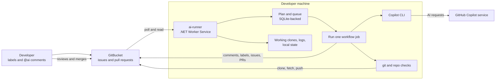
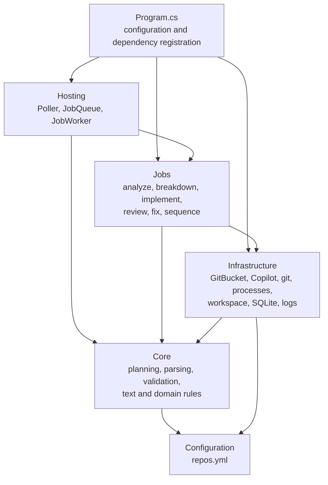

# ai-workflow

`ai-workflow` is a local automation service for using GitHub Copilot CLI with GitBucket issues and pull requests. Its worker, `ai-runner`, runs on a developer's machine, polls GitBucket, and starts the appropriate AI-assisted workflow. It can analyze and break down issues, implement approved work, review pull requests, and apply requested review fixes.

The runner exists to connect GitBucket to a Copilot CLI session on a developer's computer. GitBucket does not need to call into the machine: the runner pulls work from GitBucket, uses a local clone of each configured repository, then posts results and branches back. **A person reviews and merges every pull request; the runner never merges.**

## At A Glance



The recurring path is **Poll -> Plan -> Queue -> Job**. Each job re-reads the latest issue or pull request and checks the plan again before acting, so stale or duplicate queued work is harmless.

## Workflows

Workflows are enabled per repository in `repos.yml`. The runner only considers configured repositories.

| Workflow | How it starts | What it does |
| --- | --- | --- |
| Analyze | Put the `ai` label on an issue. Follow-up analysis requires a new `@ai` comment. | Copilot asks questions, records assumptions and a plan, and classifies the work. When ready, it produces a SPEC. |
| Break down | Add `ai-breakdown` to an issue marked `ai:ready` and `ai:complex`. | Creates a feature branch and sub-issues. The runner can sequence the sub-issues and open a final PR when they are complete. |
| Implement | Add `ai-implement` to an issue marked `ai:ready` and `ai:simple`. | Copilot changes code in a local clone. The runner verifies configured build, test, lint, and PR-description checks, then pushes a branch and opens a PR. |
| Review | A new commit on an in-scope pull request. By default, scope is pull requests labelled `ai` and those opened by this runner. | Copilot posts or updates a review comment. Draft PRs and PRs titled `[skip-ai]...` are skipped. |
| Review fix | Add `@ai` to a comment on an in-scope pull request. | Copilot applies the requested fixes. The runner pushes to the PR branch only when configured build, test, or lint checks pass; otherwise it saves the work on a separate branch. |

Analysis and review are read-only. Implementation and review fixes can change code, but all resulting changes still require human review. The `needs-cloud-agent` and `ai:on-github` labels currently tell the planner to skip an issue; the GitHub fallback workflow is **not implemented**.

## Getting Started

### Requirements

- .NET 10 SDK
- `git` on `PATH`
- GitHub Copilot CLI installed and signed in
- Network/VPN access to the configured GitBucket server
- A GitBucket account and API token

Add the token to .NET user secrets; do not put credentials in `repos.yml`:

```powershell
dotnet user-secrets set GitBucket:Token <token> --project src/AiRunner
```

Configure `gitBucket.baseUrl` and at least one repository in [`repos.yml`](repos.yml). For implementation and review fixes, configure the repository's setup/build/test/lint commands there. The commands are stack-agnostic and run in the product repository's working clone.

### Run

Run these commands from the repository root:

```powershell
# Build and test
dotnet build ai-workflow.slnx
dotnet test ai-workflow.slnx

# Create workflow labels in configured repositories
dotnet run --project src/AiRunner -- --setup-labels

# Poll once and show the planned work without running jobs
dotnet run --project src/AiRunner -- --once --dry-run

# Poll once, run queued jobs, and exit
dotnet run --project src/AiRunner -- --once

# Run continuously until Ctrl+C
dotnet run --project src/AiRunner
```

Other diagnostic modes are `--copilot-test` (check the Copilot child process) and `--attachment-test <url>` (check a GitBucket `/_attached/` download). Normal runs and tests that invoke Copilot or GitBucket can incur cost or change remote data. The test suite uses fakes for GitBucket, Copilot, and process execution and does not need VPN access.

The runner locates `repos.yml` in the current directory or a parent directory. Use `--config <path>` to select another file. On a non-dry run, it installs the checked-out `agents/` and `skills/` definitions into `~/.copilot/`.

## Architecture



`Hosting` schedules work, `Core` makes decisions and parses agent output without doing I/O, `Jobs` orchestrate each workflow, and `Infrastructure` owns external side effects. `AgentSession` shares the agent, verification, and repair-round process between implementation and review fixes.

The runner keeps working clones under `work/`, job logs under `logs/`, and queue/polling state in `ai-runner.db`. GitBucket comments also contain markers that let the runner recognize its own output, so deleting the local database does not erase workflow history.

### Security Note

The runner removes GitBucket credentials from child-process environments and does not give the Copilot CLI the GitBucket token. However, setup/build/test/lint commands execute repository code with the developer's operating-system permissions. This is **not a sandbox**: use a machine without sensitive production access, and review all generated changes before merging. Anyone with permission to label an issue or comment `@ai` on an in-scope pull request may trigger work, including paid Copilot requests.

## Repository Guide

- [Getting started and configuration](docs/01-getting-started.md)
- [Architecture and design rules](docs/02-architecture.md)
- [System overview](docs/00-overview.md)
- [Documentation index](docs/README.md)
- [`agents/`](agents/) contains Copilot agent definitions; [`skills/`](skills/) contains supporting skills.
- [`templates/`](templates/) defines the structured output formats validated by the runner.
- [`onboarding/AGENTS.md`](onboarding/AGENTS.md) is the starting point for configuring a product repository.
- [`tests/AiRunner.Tests/`](tests/AiRunner.Tests/) contains tests organized around the source layers.
