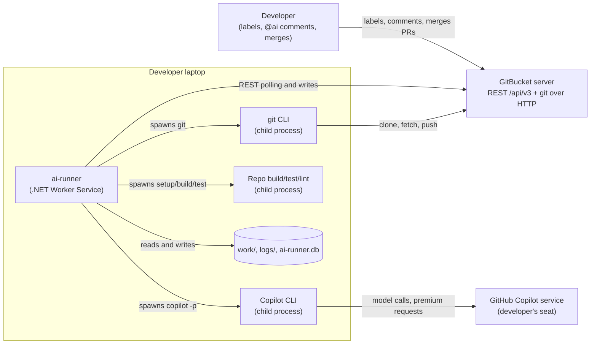
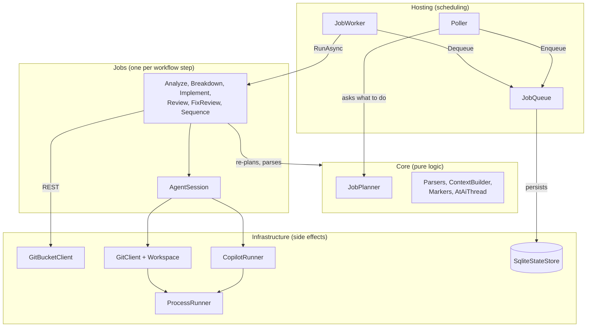

# 00 - Overview

## What this system does

`ai-runner` is a .NET Worker Service that runs on a developer's laptop. It **polls a GitBucket server** (GitHub-compatible `/api/v3`), decides which issues and pull requests need work, and runs **GitHub Copilot CLI** (`copilot -p --agent ...`) to do that work. It then writes the results back to GitBucket as comments, labels, branches, sub-issues and pull requests.

It exists because GitBucket cannot call into a laptop (no webhooks) and the Copilot seat lives on the developer's machine. So the runner pulls, instead of being pushed to.

Users are developers on the team. They drive the runner only by **labels** (`ai`, `ai-breakdown`, `ai-implement`) and by writing **`@ai`** in comments. A human always does the final merge. The runner never merges.

## Main capabilities (workflows)

| # | Workflow | Trigger | Result |
| --- | --- | --- | --- |
| 1 | Analysis (`analyze`) | issue with label `ai`, or a new `@ai` comment | A comment with questions, assumptions, plan, complexity. When ready, also a SPEC comment. |
| 1b | Breakdown (`breakdown`) | human adds `ai-breakdown` on an `ai:ready` + `ai:complex` issue | Feature branch `feat/issue-N` and one sub-issue per sub-task; later sub-issues start by themselves; a final PR is opened. |
| 2 | Implement (`implement`) | human adds `ai-implement` on an `ai:ready` + `ai:simple` issue | Code on branch `ai/issue-N`, verified by the runner, then a PR. |
| 3 | PR review (`review`) | new head commit on a PR in review scope | One review comment, updated in place. |
| 3b | Review fix (`fix`) | `@ai` comment on a PR in scope | Copilot changes the PR branch, the runner adds a commit and replies. |
| 4 | GitHub fallback | label `needs-cloud-agent` | **Not built.** The label only makes the planner skip the issue (`src/AiRunner/Core/JobPlanner.cs:26`). |

Source of truth for workflow names: `src/AiRunner/Configuration/RunnerConfig.cs:55`.

## Tech stack

| Layer | Technology | Version | Where |
| --- | --- | --- | --- |
| Runtime | .NET (Worker Service, generic host) | net10.0 | `src/AiRunner/AiRunner.csproj` |
| Hosting | Microsoft.Extensions.Hosting | 10.0.0 | same |
| Local state | SQLite via Microsoft.Data.Sqlite | 10.0.0 | same |
| Native SQLite | SQLitePCLRaw.lib.e_sqlite3 (pinned for NU1903) | 2.1.13 | same |
| Config | YamlDotNet (`repos.yml`) | 16.3.0 | same |
| Tests | xUnit | 2.9.3 | `tests/AiRunner.Tests/AiRunner.Tests.csproj` |
| Git server | GitBucket (`/api/v3`) | external | `repos.yml` `gitBucket.baseUrl` |
| AI agent | GitHub Copilot CLI | external, version not pinned | `repos.yml` `copilot.command` |
| VCS client | `git` CLI | external, version not pinned | `Infrastructure/GitClient.cs` |

## Diagram: system context

*The runner sits between GitBucket and Copilot. Everything it starts is a child process on the same laptop. Workflow 4 (GitHub mirror) is not part of this picture because it is not built.*

## Diagram: high-level architecture

*Pattern: **Poll -> Plan -> Queue -> Job**. Dependency direction is `Hosting -> Jobs -> Infrastructure + Core`. See [02-architecture](02-architecture.md).*

## Repository map

| Path | What it is |
| --- | --- |
| `src/AiRunner/` | The runner. One project. Folder = namespace. |
| `src/AiRunner/Core/` | Pure logic: planner, parsers, naming, text building. No I/O. |
| `src/AiRunner/Infrastructure/` | Every side effect behind an interface (GitBucket, Copilot, git, processes, SQLite, logs). |
| `src/AiRunner/Jobs/` | One `IJob` per workflow step, plus `AgentSession` shared by implement and fix. |
| `src/AiRunner/Hosting/` | `Poller`, `JobQueue`, `JobWorker`, `LabelSetup`, `CopilotSelfTest`. |
| `src/AiRunner/Configuration/` | `RunnerConfig` and the other POCOs for `repos.yml`. |
| `tests/AiRunner.Tests/` | xUnit tests, mirrors the layers. GitBucket, Copilot and processes are faked. |
| `agents/` | Copilot agent definitions (`grill-issue`, `implement-issue`, `fix-review`, `pr-review`, `code-reviewer`). Copied to `~/.copilot/agents/` at start. |
| `skills/` | Copilot skills (`grill-me`, `implement-checklist`, `review-checklist`). Copied to `~/.copilot/skills/`. |
| `templates/` | The exact output formats the agents must write. Copied into each work folder as `.ai-workflow/templates/`. |
| `onboarding/AGENTS.md` | Starting point a product repo copies to its root. |
| `repos.yml` | Runtime config: server URL, repos, commands, limits. |
| `test/issue-52/` | Two raw text samples (`round1.txt`, `round2.txt`). Not referenced by code. See [06-findings](06-findings.md). |
| `CLAUDE.md`, `README.md`, `CONTEXT.md` | Existing project notes. `CONTEXT.md` is the glossary for the `@ai` thread vocabulary. |
| `ai-workflow.slnx` | Solution file (src + tests). |

Local, git-ignored folders created at run time: `work/` (one clone per repo), `logs/` (job folders and `cost.csv`), `ai-runner.db` (SQLite). See `.gitignore`.

## Where to go next

- Run it: [01-getting-started](01-getting-started.md)
- Understand the design: [02-architecture](02-architecture.md)
- Dig into one workflow: [modules/](modules/)
