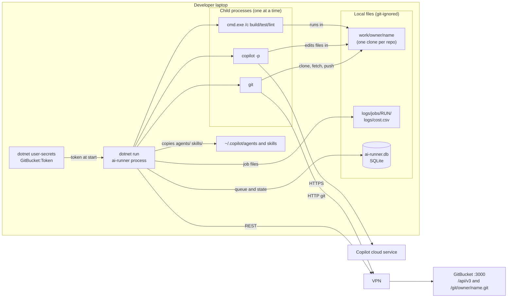

# 01 - Getting started

## Prerequisites

| Need | Why | Check |
| --- | --- | --- |
| .NET 10 SDK | `net10.0` target (`src/AiRunner/AiRunner.csproj`) | `dotnet --version` |
| `git` on PATH | The runner clones and pushes with the git CLI (`Infrastructure/GitClient.cs`) | `git --version` |
| GitHub Copilot CLI, logged in | The runner starts `copilot -p`. Copilot uses the developer's own login. | `copilot --version` |
| VPN to the GitBucket server | `gitBucket.baseUrl` in `repos.yml` is an internal address | open the URL in a browser |
| A GitBucket user for the bot + an API token | The runner posts as this user. Its login is read at start (`Program.cs:89`). | token in user secrets |

Tests need **none** of the network items: GitBucket, Copilot and processes are faked (`tests/AiRunner.Tests/Fakes/`). `GitWorkspaceTests` uses real `git` against a `file://` bare repo.

## Install and configure

```powershell
cd <repo root>
# 1. Token (never put it in repos.yml)
dotnet user-secrets set GitBucket:Token <ai-bot token> --project src/AiRunner
# only if git over HTTP needs a different password than the token:
dotnet user-secrets set GitBucket:GitPassword <password> --project src/AiRunner
# 2. The bot account's sign-in password goes in repos.yml (git_bucket.web_password), not in user secrets:
#    GitBucket's API cannot close an issue, so the runner uses the web page.

# 3. Edit repos.yml (server URL, repos, commands, limits). See the table below.
```

`repos.yml` is searched in the current folder and then in each parent folder (`Program.cs:122`), or given with `--config <path>`. Every relative path inside it (`paths.*`) is resolved against the folder that holds `repos.yml` (`RunnerConfig.ResolvePath`, `Configuration/RunnerConfig.cs:25`). The shared `agents/`, `skills/` and `templates/` folders are also looked up there.

## Run

```powershell
dotnet run --project src/AiRunner -- --copilot-test     # start copilot as a child process (spends 2 requests, needs no GitBucket)
dotnet run --project src/AiRunner -- --setup-labels     # create the workflow labels in every repo
dotnet run --project src/AiRunner -- --once --dry-run   # poll once, print the plan, change nothing
dotnet run --project src/AiRunner -- --once             # poll once, run queued jobs, exit
dotnet run --project src/AiRunner                       # loop: poll every pollIntervalSeconds, Ctrl+C to stop
```

Mode flags are parsed by hand at the top of `Program.cs:13-17`. They are not passed to the .NET host, so they never become config keys.

> **Do not** run `--copilot-test`, `--once` (without `--dry-run`) or the loop casually. They spend Copilot premium requests and write to the real GitBucket (project rule in `CLAUDE.md`).

## Test and build

```powershell
dotnet build ai-workflow.slnx
dotnet test  ai-workflow.slnx
```

About 180 test methods in 16 files (`[Fact]`/`[Theory]` count). No lint or format command is configured in the repo.

## Configuration reference (`repos.yml`)

Names are camelCase in YAML (`CamelCaseNamingConvention`, `RunnerConfig.cs:48`). Unknown keys are ignored (`IgnoreUnmatchedProperties`). A missing `gitBucket.baseUrl` or an unknown workflow name stops start-up (`RunnerConfig.cs:39-42`).

### Top level

| Key | Purpose | Default | Example | Required |
| --- | --- | --- | --- | --- |
| `gitBucket.baseUrl` | Server root. `/api/v3/` is added. | none | `http://10.221.10.34:3000` | **yes** |
| `pollIntervalSeconds` | Seconds between polls in loop mode | 90 | `90` | no |
| `scopeLabel` | Label that puts an issue in scope (also marks PRs for review/fix) | `ai` | `ai` | no |
| `copilot.command` | Copilot executable. Use the full path if Windows cannot find it. | `copilot` | `copilot` | no |
| `copilot.analyzeTimeoutMinutes` | Per Copilot call, analysis | 15 | `15` | no |
| `copilot.reviewTimeoutMinutes` | Per Copilot call, PR review | 15 | `15` | no |
| `copilot.implementTimeoutMinutes` | Per Copilot call and per check command, implement and fix | 30 (class default; the shipped file says 45) | `45` | no |
| `copilot.extraArgs` | Extra flags on every Copilot call | `[]` | `[--disable-builtin-mcps]` | no |
| `paths.work` / `paths.logs` / `paths.state` | Clones, logs, SQLite file | `work`, `logs`, `ai-runner.db` | | no |
| `logRetentionDays` | Age after which job log folders and finished job rows are deleted | 30 | `30` | no |
| `git.userName` / `git.userEmail` | Author of commits the runner makes. The e-mail also tells "my own earlier work" apart from a person's (`ImplementIssueJob.cs:89`). | `ai-runner`, `ai-runner@localhost` | | no |
| `repos[]` | One entry per product repo | `[]` | | yes, to do anything |

### Per repo (`repos[]`)

| Key | Purpose | Default |
| --- | --- | --- |
| `owner`, `name` | Repo `owner/name` on GitBucket | required |
| `workflows` | Enabled workflows: `analyze`, `breakdown`, `implement`, `review`, `fix` | `[]` (nothing runs) |
| `models` | Model per workflow, e.g. `{ analyze: ..., review: ... }`. Empty = Copilot default | `{}` |
| `commands.setup/build/test/lint` | Shell commands of the product repo, any stack. Empty = not used. | none |
| `commands.allowShell` | Extra Copilot shell patterns, e.g. `["npm:*"]` | `[]` |
| `limits.maxChangedFiles` / `maxDiffLines` | "Still simple?" limits for implement | 15 / 800 |
| `limits.maxAnalysisRounds` | Analysis replies per issue | 5 |
| `limits.maxReviewFixes` | Review-fix replies per PR | 5 |
| `implement.maxFixRounds` | Extra Copilot rounds after the runner's own checks fail. Also used by `fix`. | 2 |
| `review.scope` | `scoped` (labelled + runner-opened PRs) or `all` | `scoped` |
| `review.skipPaths` | Globs; a PR that changes only these is not reviewed | `[]` |
| `autoStartFirstSubIssue` | Breakdown adds `ai-implement` to sub-issue 1 | `false` |

### Secrets and environment

| Name | Purpose | Required |
| --- | --- | --- |
| `GitBucket:Token` (user secrets) | GitBucket API token and default git password | **yes** (except `--copilot-test`) |
| `GITBUCKET_TOKEN` (env) | Same token, used when the secret is not set (`Program.cs:27-30`) | alternative |
| `GitBucket:GitPassword` (user secrets) | Password for git over HTTP, if not the token | no |
| `git_bucket.web_password` (repos.yml only) | Sign-in password of the token's user. `/api/v3` has no route to close an issue, so the runner signs in on the web page and posts its close form. Without it, closing an issue after a merge fails the job. It is kept out of the config the dashboard gets (`ConfigFile`). Check it with `--close-test owner/repo#n` (closes that issue). | for closing issues |
| `COPILOT_GITHUB_TOKEN` (env) | Explicit seat token for Copilot. It is the only token variable **kept** for child processes. | no |

`ProcessRunner` removes `GITBUCKET_TOKEN`, `GitBucket__Token`, `GitBucket__GitPassword`, `GH_TOKEN`, `GITHUB_TOKEN`, `AIRUNNER_GITHUB_TOKEN` from every child process (`Infrastructure/ProcessRunner.cs:51`).

## Diagram: local dev setup



*Everything runs in one process tree on the laptop. The only server the runner needs is GitBucket (over VPN). The Copilot CLI reaches its own cloud service with the developer's login.*

## Files the runner writes

| Path | Content | Safe to delete? |
| --- | --- | --- |
| `work/<owner>/<name>/` | Persistent clone, reset with `git reset --hard` + `git clean -fdx` before each job (`GitClient.cs:62`) | yes, re-cloned |
| `logs/jobs/<time>-<owner>-<repo>-<n>-<Type>/` | `context.md`, raw Copilot output, round transcripts, check output, `job.log` | yes |
| `logs/cost.csv` | One row per job. If Excel has it open, the row is only in SQLite. | yes |
| `ai-runner.db` | Poll fingerprints, handled-comment cursors, review state, job queue, cost rows | yes (see [03-data-model](03-data-model.md)) |
| `~/.copilot/agents`, `~/.copilot/skills` | Overwritten from this repo on each non-dry start (`AgentInstaller.cs`) | will be re-copied |

## Onboard a product repo

1. Copy `onboarding/AGENTS.md` to the product repo root and fill it in (build/test commands, folder map, never-edit folders).
2. Add the repo to `repos.yml` with the same commands.
3. Run `--setup-labels`.
4. Put the label `ai` on an issue and run `--once --dry-run` to watch the plan.
