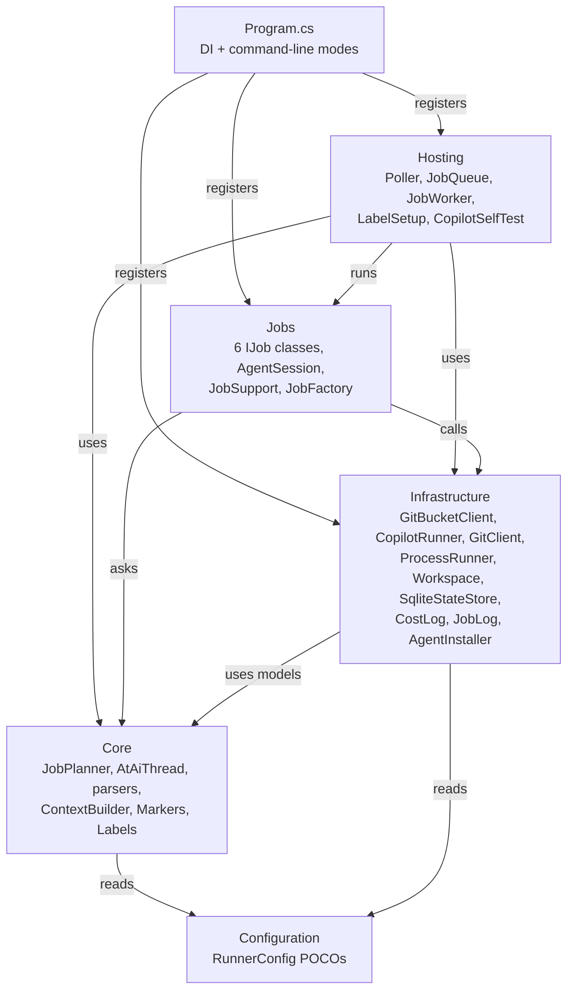
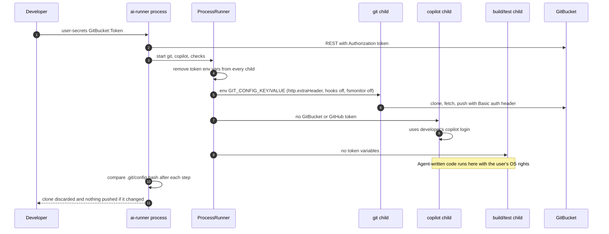
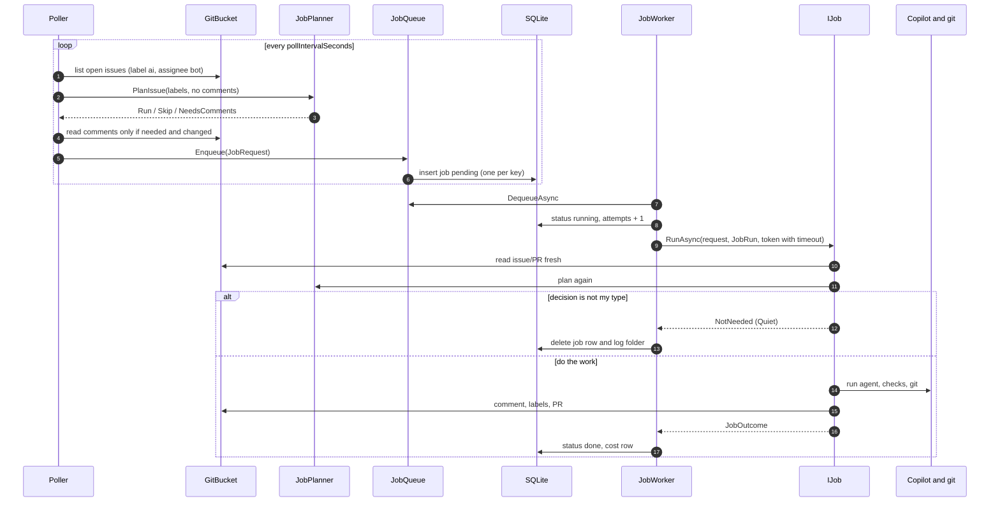

# 02 - Architecture

## Style

A single-project, **layered** architecture with one flow pattern: **Poll -> Plan -> Queue -> Job**.

- One project (`src/AiRunner`), folder = namespace.
- Dependency direction: `Hosting -> Jobs -> Infrastructure + Core`. `Core` may depend only on the `Configuration/` POCOs (rule from `CLAUDE.md`; checkable by reading the `using` lines in `Core/*.cs`).
- All **decisions** and all **text parsing** are pure functions in `Core` (no I/O, no DI, no async). All **side effects** sit behind small interfaces in `Infrastructure`. **Jobs** orchestrate. **Hosting** only schedules.
- No web server. No dependency-injection abstractions beyond the generic host; every service is a singleton (`Program.cs:33-70`).

### Diagram: layers and dependencies

*Arrows point from the user to the thing used. `Infrastructure` also references `Core` for the GitBucket models (`Gb*` records) and `AsciiSanitizer`. `Core` never references `Infrastructure`.*

## Key design rules and where they show up

| Pattern / rule | Where | Why |
| --- | --- | --- |
| **Re-plan on every job start** | `Jobs/JobSupport.cs:26` `LoadIssueAsync`, `:40` `PlanPullAsync`, `:52` `LoadPullAsync` | Jobs read fresh data and ask `JobPlanner` again. If the answer is no longer this job's `Type`, the job returns `NotNeeded` and leaves no trace. Duplicate or late jobs become harmless. The planner is the single source of "should this run". |
| **Decision objects** | `Core/JobRequest.cs` `PlanDecision`, `Core/ImplementGate.cs`, `Core/SubIssueSequencer.cs` | Rules return a value (`Run`/`Skip`, `Fix`/`Done`, `StartNext`/`Wait`) so tests need no fakes. |
| **Interfaces for side effects** | `IGitBucketClient`, `ICopilotRunner`, `IGitClient`, `IProcessRunner`, `IWorkspace`, `IStateStore`, `ICostLog` | A GitBucket or CLI quirk is fixed in exactly one class; tests swap in fakes. |
| **Job metadata on the job** | `Jobs/IJob.cs:36` `JobInfo` | `JobWorker` never switches on job type. It reads workflow name, timeout, description, "is PR", retry text from `IJob.Info`. |
| **Template method via record** | `Jobs/AgentSession.cs:14` `AgentTask` | Implement and review-fix share one agent loop; they differ only in the data in an `AgentTask`. |
| **Strict output contract** | `templates/` + `Core/*Parser.cs` + `agents/*.agent.md` + `tests/.../Samples.cs` | A bad agent answer fails the job before anything is posted. Changing a template means changing all four. |
| **State in GitBucket, not in the DB** | `Core/BotComments.cs`, `Core/Markers.cs`, `Core/AtAiThread.cs`, `Core/SubIssueBody.cs` | Hidden markers in comments let the runner find its own work. Deleting `ai-runner.db` is safe. |
| **One pending job per key** | `Hosting/JobQueue.cs:22` | Avoids piles of identical work. A newer request only updates the payload. |
| **Fail loudly, once** | `Hosting/JobWorker.cs:112` `ReportFailureAsync` | One comment + `ai:failed` (issues). A human reads the log, removes the label, and the planner may run again. |

## Cross-cutting concerns

### Authentication and authorization

- **To GitBucket REST**: `Authorization: token <GitBucket:Token>` set once on the `HttpClient` (`Program.cs:36-45`).
- **To GitBucket git**: HTTP Basic `login:secret` placed in `GIT_CONFIG_*` environment variables of each git call as `http.extraHeader`. Never on the command line, never in `.git/config` (`Infrastructure/GitClient.cs:141-162`).
- **To Copilot**: the developer's own `/login`. The child process has no GitBucket or GitHub token in its environment.
- **Who is the bot**: `GET /user` at start gives `identity.Login` (`Program.cs:89`). It is used for the scope guard and to tell "PRs I opened" apart.
- **Who may trigger work**: there is no allow-list. Anyone who can label an issue or write `@ai` on an in-scope item can start paid work. Trust is the GitBucket permission model. See [06-findings](06-findings.md).

### Diagram: trust boundaries and credential flow

*Tokens reach only the runner process and the `git` children. Copilot and the repo's build/test commands run without them, but they still run with the developer's OS rights, so this is a guard rail, not a sandbox (README "Security limits").*

### Logging

- Console: `AddSimpleConsole` with a short time stamp (`Program.cs:24-25`). Default providers are cleared.
- Per job: `JobRun` writes `job.log` and the input/output files into `logs/jobs/<run>/` (`Infrastructure/JobLog.cs`). The folder is created on first write, so a job that writes nothing leaves nothing.
- Cost: one row per job in `cost_log` and `logs/cost.csv` (`Infrastructure/CostLog.cs`).

### Error handling

| Kind | How | Where |
| --- | --- | --- |
| Expected failure (bad agent output, Copilot timeout, quota, refusal) | throw `JobFailedException(message)`; message is posted on the issue/PR | `Jobs/IJob.cs:47` |
| Unexpected exception | caught in `JobWorker.RunOneAsync`, shown as `TypeName: short message`, same reporting | `Hosting/JobWorker.cs:83-89` |
| Job timeout | linked `CancellationTokenSource.CancelAfter(job.Info.Timeout)` -> "did not finish within N minutes" | `Hosting/JobWorker.cs:58-60, 85-87` |
| Runner stops (Ctrl+C) | job stays `running`, is re-queued once on next start | `Hosting/JobWorker.cs:76-80`, `JobQueue.cs:64` |
| Poll error for one repo | logged, other repos continue | `Hosting/Poller.cs:42-46` |
| Quota exhausted | text match on `premium request`, `quota`, `rate limit` -> clearer message | `Infrastructure/CopilotRunner.cs:50` |

### Validation

Input from agents is validated in `Core` parsers before posting: `AnalysisParser`, `BreakdownParser`, `ReviewParser` throw `FormatException` (turned into a job failure by `JobSupport.Parse`). `PrBodyParser` and `ReviewReplyParser` return a list of problems instead, which feeds a fix round.

### Caching and cost control

No cache. The poller saves a **fingerprint** (`updated_at` + labels) per issue and reads comments only when the fingerprint changed *and* the plan needs them (`Hosting/Poller.cs:66-72`). Details in [modules/polling-and-queue](modules/polling-and-queue.md).

### Background jobs and transactions

- `Poller` and `JobWorker` are `BackgroundService`s in loop mode (`Program.cs:71-76`). With `--once`, `Program.cs:107-111` calls them directly.
- **One job at a time** (a single worker loop) so cost is predictable.
- No database transactions. Each SQLite call opens its own connection and commits. Multi-step GitBucket changes (comment + labels) are not atomic; the code orders them so a failure leaves a retryable state (see gotchas in each module).

## Diagram: lifecycle of one unit of work (poll to job)

*The poller never writes to GitBucket. Only jobs do. Every job re-checks the plan, so a stale queue entry cannot cause a wrong action.*

## Where to read next

- Data and state: [03-data-model](03-data-model.md)
- The CLI and the GitBucket calls: [04-api](04-api.md)
- One folder per workflow: [modules/](modules/)
