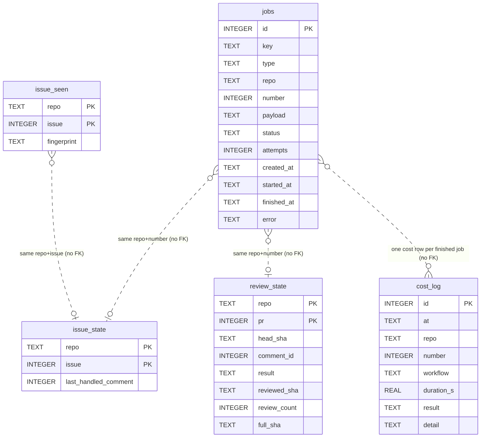
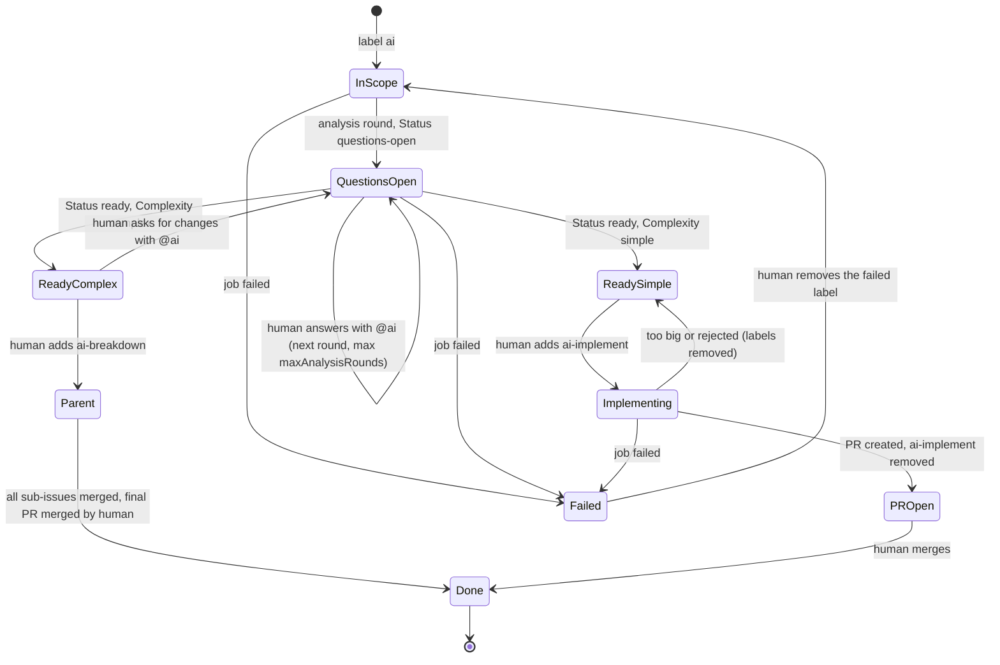
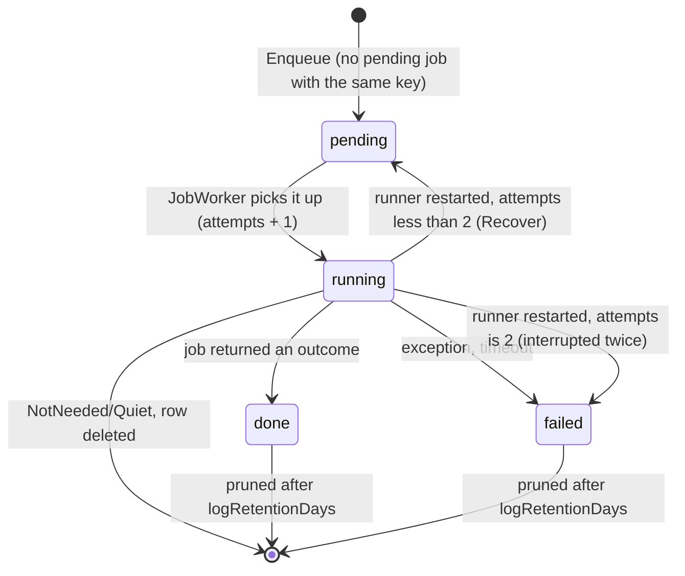
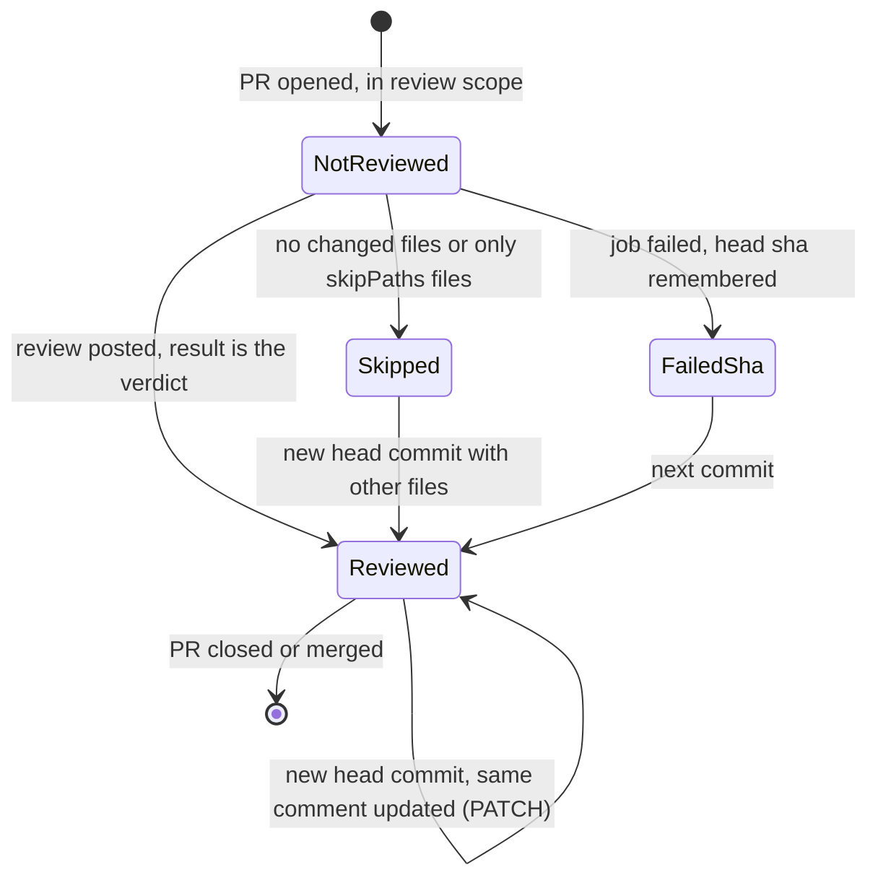

# 03 - Data model

The runner has **two kinds of state**:

1. **Local SQLite file** (`ai-runner.db`) - a cache and a job queue. Losing it is safe.
2. **GitBucket itself** - labels, hidden comment markers and PR/branch names. This is the state that matters for correctness.

> Rule from `CLAUDE.md`: *"No database dependency for correctness."* The runner finds its own comments by markers, so deleting `ai-runner.db` costs only some repeat reads and, at worst, one repeat of unfinished work.

## Database

- Engine: SQLite through `Microsoft.Data.Sqlite`. File path: `paths.state` in `repos.yml` (default `ai-runner.db`).
- Access: `Infrastructure/SqliteStateStore.cs`. Each call opens its own connection (pooling on). No ORM.
- Schema: created with `CREATE TABLE IF NOT EXISTS` in the constructor (`SqliteStateStore.cs:66-79`).
- **Migrations: none.** There is no version table. A schema change needs a manual step or deleting the file. See [06-findings](06-findings.md).

### Diagram: ER diagram of `ai-runner.db`

*There are **no foreign keys**. The tables are linked only by the `(repo, number)` pair. `issue_state` is used for both issues and PRs (the column is called `issue`, but a PR number goes there for review fixes).*

### Tables

| Table | Purpose | Written by | Read by |
| --- | --- | --- | --- |
| `issue_seen` | Fingerprint (`updated_at` + sorted lower-case labels) of the last poll where an issue needed nothing. Same fingerprint = comments are not read again. | `Poller.PollRepoAsync` (`Hosting/Poller.cs:74`) | `Poller` |
| `issue_state` | `last_handled_comment`: the newest `@ai` comment id the runner already answered (the **local cursor**). Updated with `MAX(old, new)` so it never moves back. | `AnalyzeIssueJob`, `FixReviewJob` (reply and `OnFailed`) | `JobSupport` -> `JobPlanner` |
| `review_state` | Per PR: last handled `head_sha`, the id of the review comment, and `result` (the verdict, `skipped`, `failed` or `pending`); `reviewed_sha` (head of the last posted review, base of the next incremental one), `review_count` (automatic reviews, `limits.max_reviews`) and `full_sha` (head that got the full review the label `ai-review-full` asked for). A null value keeps the old one (`COALESCE`); the comment tag `<!-- ai-runner:review sha=.. n=.. -->` carries the count on when the database is gone (a PR at the limit then gets one more review, which stores the count again). | `ReviewPullRequestJob` | `JobSupport.PlanPullAsync`, `ReviewPullRequestJob` |
| `jobs` | The persistent queue. `key` = `Type:repo#number`. One `pending` row per key at a time. | `JobQueue`, `JobWorker` | `JobQueue` |
| `cost_log` | One row per finished (or failed) job: workflow, seconds, result, detail, Copilot calls, tokens and credits (`nano_aiu`, from `--usage-output-file`). Mirrors `logs/cost.csv`. | `CostLog` -> `IStateStore.AddCost` | humans (SQL/CSV) |

Details worth knowing:

- `jobs.key` format: `JobRequest.Key` = `$"{Type}:{Repo}#{Number}"` (`Core/JobRequest.cs`). Index `ix_jobs_status (status, key)`.
- `jobs.payload`: the PR head sha for a review, the `@ai` comment id for a review fix, null otherwise.
- `jobs.attempts` increases each time a job goes to `running` (`SqliteStateStore.cs:145`).
- `PruneJobs` deletes `done`/`failed` rows older than `logRetentionDays` at each worker start (`JobWorker.cs`).
- `cost_log` rows are never pruned.

## State that lives in GitBucket

| Thing | Format | Defined in | Meaning |
| --- | --- | --- | --- |
| Bot comment marker | `<!-- ai-runner -->` plus visible `**[ai-runner]**` | `Core/BotComments.cs:13-16`, added by `GitBucketClient.WithMarker` (`GitBucketClient.cs:136`) | "I wrote this." Bot comments are never treated as human requests. |
| Block markers | `<!-- ANALYSIS_START -->`..`_END`, `SPEC`, `REVIEW`, `REVIEW_FIX` | `Core/Markers.cs:10-13` | The kind of a bot comment. The **last** start marker in agent output is used. |
| Read-up-to tag | `<!-- ai-runner:context-upto=<id> -->` | `Core/AtAiThread.cs:15` | Newest comment id the job had read when it replied. Later comments count as new even if written while Copilot ran. |
| Sub-issue list | `<!-- SUBISSUES: 12,13,14 -->` in the parent's breakdown comment | `Core/SubIssueBody.cs:76` | Build order of sub-issues. |
| Sub-issue body header | `Parent: #n` / `Order: k of K` / `Base branch: ...` / `Depends on: ...` | `Core/SubIssueBody.cs:18-40` | Lets the implement job read its place from the issue itself. |
| Labels | see below | `Core/Labels.cs` | The workflow state machine. |
| Branches | `ai/issue-N`, `ai/issue-P-K`, `feat/issue-P` | `Core/Labels.cs` (`Branches`) | Work branches. `ai/*` and `feat/issue-*` mark runner-made PRs. |

`Markers.Wrap` replaces `<!--` inside agent text with `&lt;!--` (`Core/Markers.cs:36`). Agent output can therefore never fake a marker or a `context-upto` tag.

## Labels

| Label | Set by | Meaning |
| --- | --- | --- |
| `ai` (`scopeLabel`) | human | Issue is in scope. On a PR: opt in to review and fix. |
| `ai:questions-open` | bot | Analysis posted, author must answer and write `@ai`. |
| `ai:ready` | bot | No open questions left. |
| `ai:simple` / `ai:complex` | bot | Complexity guess. |
| `ai-breakdown` | human | Breakdown approved. |
| `ai:parent` | bot | Issue was split into sub-issues. |
| `ai:sub-issue` | bot | Issue is a sub-issue. |
| `ai-implement` | human (or bot for sub-issues 2..n) | Start implementation. |
| `ai:implementing` | bot | Copilot is working or a PR is open. |
| `ai:failed` | bot | A job failed. A human removes it to retry. |
| `ai:on-github`, `needs-cloud-agent` | human / future | Planner skips the issue. Workflow 4 not built. |

### Diagram: lifecycle of an issue (by labels)

*Simplified: `Failed` can happen from any state with a running job. `PROpen` keeps the label `ai:implementing`. The sub-issue path is described in [modules/analysis-and-breakdown](modules/analysis-and-breakdown.md).*

### Diagram: lifecycle of a stored job (`jobs.status`)

*Constants: `JobStatus` in `Infrastructure/SqliteStateStore.cs:8-14`, `MaxAttempts = 2` in `Hosting/JobQueue.cs:16`.*

### Diagram: lifecycle of a PR review (`review_state.result`)

*The planner compares `review_state.head_sha` to the PR head: equal = "head already reviewed" (`Core/JobPlanner.cs:156`). A failed review stores the failed sha, so it is not retried every poll; the next commit is reviewed again (`ReviewPullRequestJob.cs:29-31`).*

## Important in-memory entities

| Type | File | Purpose |
| --- | --- | --- |
| `JobRequest(Type, Repo, Number, Payload)` | `Core/JobRequest.cs` | A unit of work. Small enough to persist. |
| `PlanDecision(Job, Reason, Routine, NeedsComments)` | `Core/JobRequest.cs` | Planner output: a job or "skip because ...". |
| `Gb*` records | `Core/GitBucketModels.cs` | Only the GitBucket fields the runner reads. Nullable where GitBucket may omit them. |
| `JobInfo`, `JobOutcome` | `Jobs/IJob.cs:36,40` | Job metadata and result. `Result` words: `ok`, `wip`, `red`, `rejected`, `too-big`, `not-needed`, `skipped`, `no-change`, `outdated`, `already-open`, `failed`. |
| `AtAiThread` | `Core/AtAiThread.cs` | The bot replies of one block kind plus the human comments around them (see [modules/planning](modules/planning.md)). |

## Raw SQL

All SQL is in `SqliteStateStore.cs` and uses named parameters. The two statements with logic:

- `issue_state` upsert with `MAX(last_handled_comment, $id)` (line 104).
- `review_state` upsert with `COALESCE($cid, comment_id)` (line 120).

There are no stored procedures or views.
