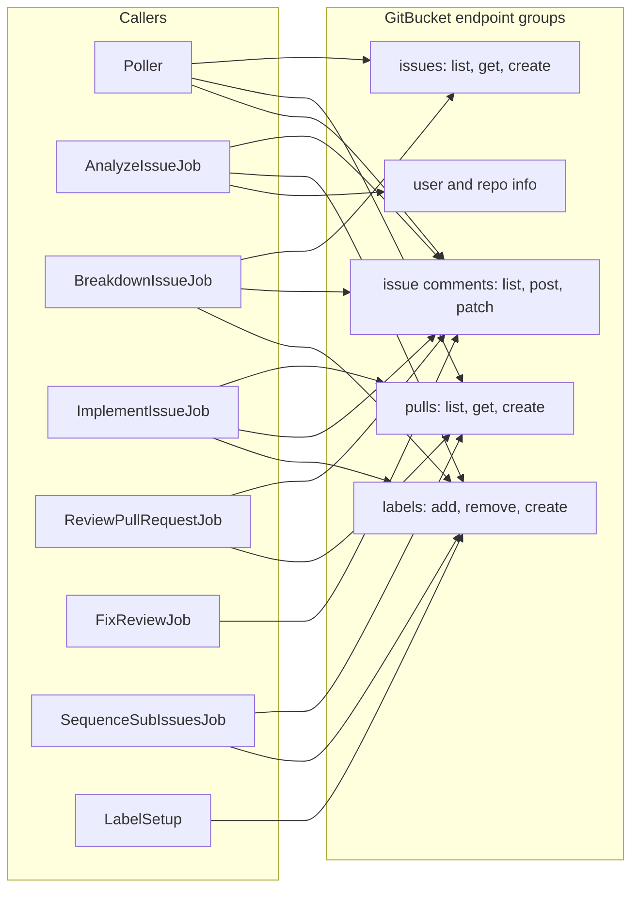

# 04 - API surface

The runner **exposes no HTTP API**. Its interfaces are:

1. The **command line** (modes).
2. The **GitBucket REST API** it calls (`IGitBucketClient`).
3. The **Copilot CLI** and **git** command lines it builds.
4. The **human interface**: labels and `@ai` comments.

## 1. Command-line modes (`src/AiRunner/Program.cs:13-17`)

| Flag | Effect | Spends Copilot requests? | Writes to GitBucket? |
| --- | --- | --- | --- |
| *(none)* | Loop: `Poller` + `JobWorker` until Ctrl+C | yes | yes |
| `--once` | One poll, run the queued jobs, exit (`Program.cs:107-111`) | yes | yes |
| `--dry-run` | Print plan only. With `--once`: one poll. Alone: loop of polls, no worker. | no | no |
| `--setup-labels` | Create all labels in every repo (`Hosting/LabelSetup.cs`) | no | yes (labels) |
| `--copilot-test` | Start copilot as a child with 2 prompts (`Hosting/CopilotSelfTest.cs`) | yes (2) | no |
| `--config <path>` | Use this `repos.yml` | - | - |

## 2. GitBucket REST calls (`Infrastructure/GitBucketClient.cs`)

Base URL: `{baseUrl}/api/v3/`. All text sent is cleaned by `AsciiSanitizer` (GitBucket answers HTTP 500 on non-ASCII). Lists are read with `per_page=100&page=n` until a page brings nothing new (max 50 pages, `GitBucketClient.cs:45,150`).

| Method | Route | Used for | Called by |
| --- | --- | --- | --- |
| GET | `/user` | Bot login at start | `Program.cs:89` |
| GET | `/repos/{o}/{r}` | `default_branch` | `JobSupport.DefaultBranchAsync` |
| GET | `/repos/{o}/{r}/issues?state=open[&labels=][&assignee=]` | Poll issues (PRs filtered out) | `Poller` |
| GET | `/repos/{o}/{r}/issues/{n}` | Fresh issue; also label re-read | `JobSupport.LoadIssueAsync`, `ApplyLabelsAsync` |
| GET | `/repos/{o}/{r}/issues/{n}/comments` | Comments of an issue **or a PR** | planner, jobs |
| POST | `/repos/{o}/{r}/issues` | Create sub-issue | `BreakdownIssueJob` |
| POST | `/repos/{o}/{r}/issues/{n}/comments` | New bot comment | all jobs |
| PATCH | `/repos/{o}/{r}/issues/comments/{id}` | Update the review comment in place | `ReviewPullRequestJob` |
| POST | `/repos/{o}/{r}/issues/{n}/labels` | Add labels | `ApplyLabelsAsync` |
| DELETE | `/repos/{o}/{r}/issues/{n}/labels/{name}` | Remove label (404 ignored) | `ApplyLabelsAsync` |
| POST | `/repos/{o}/{r}/labels` | Create label (422/409 = exists) | `LabelSetup` |
| GET | `/repos/{o}/{r}/pulls?state=open\|closed` | Poll PRs, sequencing | `Poller`, `SequenceSubIssuesJob`, `ImplementIssueJob` |
| GET | `/repos/{o}/{r}/pulls/{n}` | Fresh PR | `JobSupport.LoadPullAsync` |
| POST | `/repos/{o}/{r}/pulls` | Open PR; only `number` is read from the reply, then GET | `ImplementIssueJob`, `SequenceSubIssuesJob` |

Known GitBucket quirks the client works around:

| Quirk | Handling |
| --- | --- |
| `since` on issue lists ignored | Poller keeps its own fingerprint (`Core/GitBucketModels.cs:44` area, `Fingerprint()`). |
| Comment `DELETE` fails | Never deleted; `PATCH` is used. |
| `/pulls/{n}/files` missing | `git diff base...head` on the local clone (`GitClient.DiffAsync`). |
| Non-ASCII text -> HTTP 500 | `AsciiSanitizer.Clean` on every outgoing title/body. |
| PR create reply not readable as `GbPull` | Only `number` is trusted, then `GET`. |
| Labels on issue create may be ignored | `CreateSubIssueAsync` adds missing labels afterwards (`BreakdownIssueJob.cs:81`). |
| Only the Conversation tab's comments are read | Line comments in the diff are **not** read (README "Still to verify"). |

Errors: any non-2xx becomes `GitBucketException(status, message)`; a JSON shape error includes the raw reply (`GitBucketClient.cs:165-187`).

### Diagram: which part calls which GitBucket endpoint group



*Each job also calls `GET issue` / `GET comments` first through `JobSupport.LoadIssueAsync` (not drawn, to keep the picture small).*

## 3. Child-process command lines

### Copilot (`Infrastructure/CopilotRunner.cs:26-34`)

```text
copilot -p "<prompt>" -s [--agent <name>] [--model <m>]
        [--allow-tool=<t>]... [--deny-tool=<t>]... [--share <transcript.md>] <extraArgs>
```

| Job | Agent | Allow | Deny | Timeout per call |
| --- | --- | --- | --- | --- |
| Analyze | `grill-issue` | - | `write`, `shell` | `analyzeTimeoutMinutes` |
| Review | `pr-review` | - | `write`, `shell` | `reviewTimeoutMinutes` |
| Implement | `implement-issue` | `write` + tools of setup/build/test/lint + `allowShell` | `shell(git)`, `shell(git:*)`, `write(.ai-workflow)` | `implementTimeoutMinutes` |
| Review fix | `fix-review` | same as implement | same as implement | `implementTimeoutMinutes` |

`-s` = stdout contains only the final answer. `--share` writes the full session (tool calls, denials) as Markdown for debugging.

### git (`Infrastructure/GitClient.cs`)

`clone --no-tags`, `fetch --prune origin +refs/heads/*:refs/remotes/origin/*`, `reset --hard`, `clean -fdx`, `checkout --detach | -B`, `rev-parse`, `rev-list --count`, `log --format=%ae`, `add -A`, `diff --cached --numstat`, `commit --no-verify`, `push origin <src>:refs/heads/<branch>` (never forced), `diff base...head`.

Common config for every call (env `GIT_CONFIG_*`): `http.extraHeader` (Basic auth), empty `credential.helper`, `core.hooksPath` to a missing folder, `core.fsmonitor=false`, `core.autocrlf=false`, `core.longpaths=true`.

### Repo commands (`ProcessSpec.Shell`, `Infrastructure/ProcessRunner.cs:13`)

`cmd.exe /d /s /c "<command>"` on Windows, `/bin/sh -c` elsewhere. Used for `commands.setup/build/test/lint`.

## 4. Human interface: labels and comments

| Human action | Where | Effect |
| --- | --- | --- |
| Add `ai` to an issue | issue | Analysis round 1 |
| Comment with `@ai` | issue | Next analysis round (needs a new `@ai` comment after the last reply) |
| Reply `Q1: ...`, `A2: wrong, it is ...` | issue comment | Read by the agent as facts |
| Add `ai-breakdown` | issue `ai:ready` + `ai:complex` | Create sub-issues |
| Add `ai-implement` | issue `ai:ready` + `ai:simple` | Implement |
| Add `ai` to a PR | PR | Opt in to review and fix |
| Comment `@ai ...` | PR in scope | Review fix (`fix` workflow) |
| Title starts with `[skip-ai]`, or draft | PR | Planner skips it (`Core/JobPlanner.cs:107-110`) |
| Remove `ai:failed` | issue | Allows a retry |

`@ai` is matched by `(^|[^\w])@ai\b`, case-insensitive, on comments that are **not** bot comments (`Core/BotComments.cs:29-31`).
