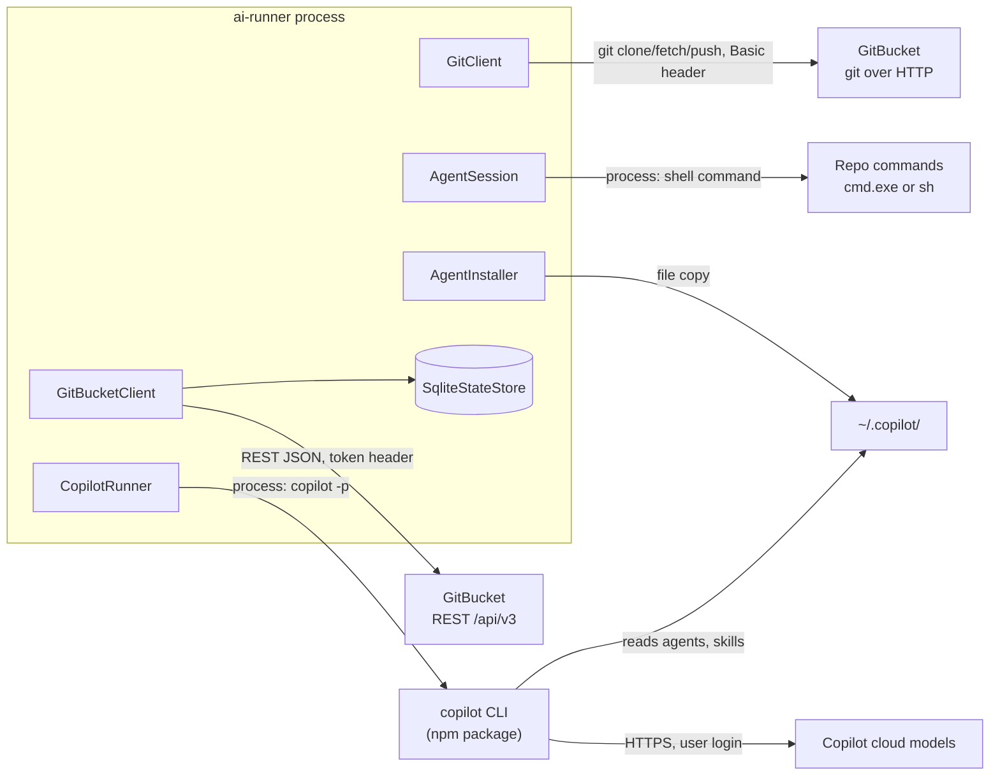
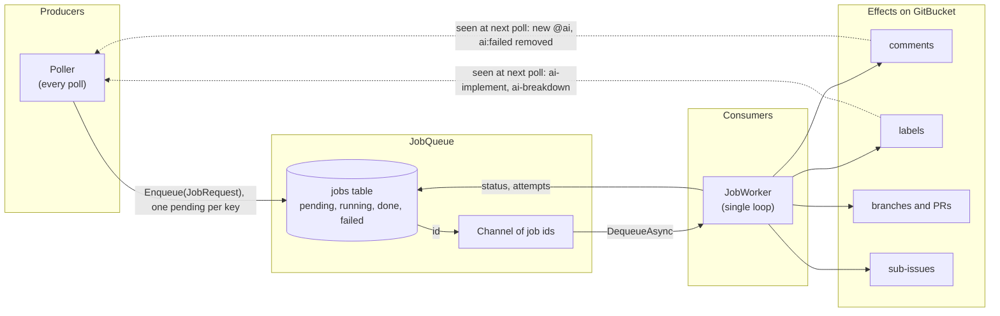
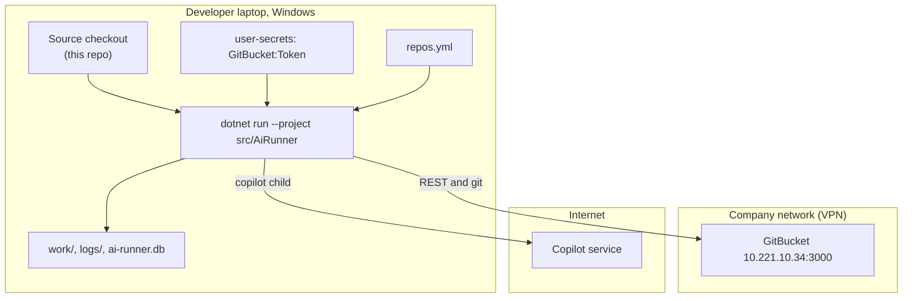

# 05 - Integrations and infrastructure

## External services

| Service | Protocol | How it is called | Auth | Failure behaviour |
| --- | --- | --- | --- | --- |
| **GitBucket** REST | HTTP/JSON, `{baseUrl}/api/v3/` | `GitBucketClient` over one `HttpClient`, 30 s timeout (`Program.cs:36-45`) | `Authorization: token <GitBucket:Token>` | Non-2xx -> `GitBucketException`. A poll error is logged per repo. A job error is reported on the issue. |
| **GitBucket** git | HTTP(S) smart protocol, `{baseUrl}/git/{owner}/{name}.git` | `git` child process (`GitClient.RemoteUrl`) | Basic `login:secret` via `GIT_CONFIG_*` env | `InvalidOperationException("git ... failed")` with the output tail |
| **GitHub Copilot CLI** | Child process, `copilot -p` | `CopilotRunner` -> `ProcessRunner` | The developer's own Copilot login; no token from the runner | Exit code, timeout, quota guess -> `JobFailedException` |
| **Repo build/test/lint** | Child process via `cmd.exe /c` (Windows) or `/bin/sh -c` | `AgentSession.RunCommandAsync` | none | Exit code decides pass/fail; timeout counts as failure |
| **Local file system** | files | `work/`, `logs/`, `ai-runner.db`, `~/.copilot/` | OS user | `CostLog` tolerates a locked CSV; other IO errors fail the job |

Not integrated: Jenkins and the GitHub mirror (Workflow 4). The README and `CLAUDE.md` mention a design document "(GitBucket + Jenkins + Copilot CLI)", but no Jenkins code exists in this repo.

### Diagram: integration map

*Four network/process boundaries: REST, git, Copilot, repo commands. Only the first two carry GitBucket credentials.*

## Scheduled work, workers and queues

| Item | Kind | Schedule | Where |
| --- | --- | --- | --- |
| `Poller` | `BackgroundService` | `PeriodicTimer(pollIntervalSeconds)`; first poll at once | `Hosting/Poller.cs:28-36` |
| `JobWorker` | `BackgroundService` | Blocks on the queue channel; one job at a time | `Hosting/JobWorker.cs:24-45` |
| Job queue | `Channel<long>` + `jobs` table | Recovered at worker start | `Hosting/JobQueue.cs` |
| `SequenceSubIssues` | A job planned **every poll** per `ai:parent` issue | every poll | `JobPlanner.cs:48-53` |
| Log cleanup | at start (non-dry) | `JobLog.Cleanup()` deletes run folders older than `logRetentionDays` | `Program.cs:104` |
| Job row prune | at worker start | `PruneJobs(now - logRetentionDays)` | `JobWorker.RecoverAsync` |

There is no external message broker, cron, or webhook receiver.

### Diagram: queue and event flow

*GitBucket is the event bus. Humans and jobs both write labels and comments; the poller sees them 90 s later (default) and plans again. Dashed arrows are indirect (through GitBucket).*

## Deployment

There is **no deployment pipeline** in the repository: no Dockerfile, no CI definition (`.github/`, `.gitlab-ci.yml`, `Jenkinsfile` are all absent), no installer, no service wrapper. The runner is started by hand with `dotnet run` on the developer's laptop.

### Diagram: deployment (as implied by the code)

*One environment only: the developer's machine. "Production" for this tool is that laptop. The IP is the value in `repos.yml`; do not treat it as a stable address.*

### Environments and how they differ

| Environment | What exists | Notes |
| --- | --- | --- |
| Local dev / "prod" | Same laptop run | `README`: "Do not run the implement workflow on a machine with production access." Agent-written build/test code runs with the user's rights. |
| Tests | xUnit with fakes; one real `git` against a `file://` bare repo | `dotnet test ai-workflow.slnx`. No CI runs it in this repo. |

### Build and release steps (manual)

1. `dotnet build ai-workflow.slnx`
2. `dotnet test ai-workflow.slnx`
3. Update `repos.yml` and (if changed) `agents/`, `skills/`, `templates/` - they are read from the repo folder at runtime and `agents/` + `skills/` are copied to `~/.copilot` at each non-dry start.
4. Restart the runner (Ctrl+C then `dotnet run`). A job running at stop time stays `running` and is re-queued once.

## Operations cheat sheet

| Question | Look at |
| --- | --- |
| Why did it not pick up my issue? | `--once --dry-run` output line for the issue: `skip (reason)` |
| Why did a job fail? | The failure comment on the issue/PR names `logs/jobs/<folder>`; read `job.log`, `error.txt`, `round-N-copilot-*`, `round-N-check-M.txt`, `fix-N.md` |
| What did Copilot do in a round? | `round-N-transcript.md` (from `--share`) |
| How much did it cost? | `logs/cost.csv` (seconds and result per job; only implement/fix write "N copilot calls" in the detail text, there is no premium-request count) |
| Reset everything local | Delete `ai-runner.db`; delete `work/` to re-clone. Both are safe. |
| Retry a failed issue job | Read the log, fix the cause, remove `ai:failed` |
| Retry a failed PR job | Review: push a new commit. Fix: write `@ai` again. |
