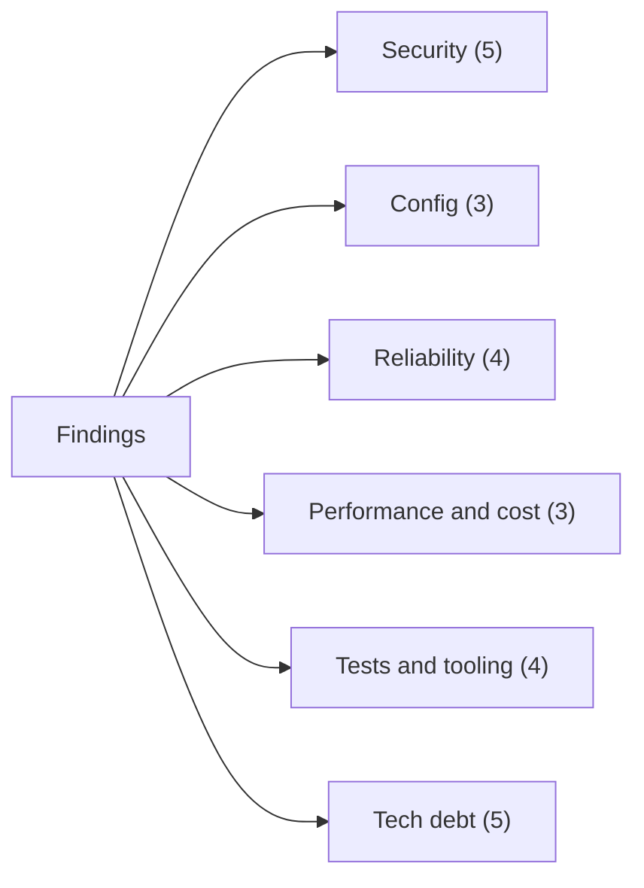

# 06 - Findings and open questions

Everything here comes from reading the code and config. Nothing was run against a real GitBucket or Copilot (project rule), and the test suite was not executed for this documentation. Severity is a judgement: **High** = can lose work or leak data, **Medium** = likely to surprise a user or cost money, **Low** = cleanliness or small risk.

*Counts are the rows in the tables below.*

## Security

| # | Severity | Finding | Where |
| --- | --- | --- | --- |
| S1 | **High** (accepted, documented) | Build, test and lint commands run code the agent wrote, with the developer's OS rights. That code can read anything the user can read, including the user-secrets file. Env tokens are stripped, but this is **not a sandbox**. | `Jobs/AgentSession.cs:51-57,105-117`; README "Security limits" |
| S2 | Medium | Anyone who can add a label to an issue or write `@ai` on an in-scope PR/issue can start paid Copilot runs, and an `@ai` comment on a PR can make the agent change its code. There is no allow-list of users. The comments are passed to the agent labelled as data, which reduces but cannot remove prompt-injection risk. | `Core/BotComments.cs:29`, `Core/ContextBuilder.cs:98`, `Jobs/FixReviewJob.cs` |
| S3 | Medium | A bot comment is recognised only by the hidden marker `<!-- ai-runner -->`. A human who pastes it is treated as the bot, so their text is not seen as an `@ai` request and is shown as `[bot]` to the agent. Marker, tag and block spoofing inside agent text is blocked by `Markers.Wrap`, but not for human text. | `Core/BotComments.cs:11-17`, `Core/ContextBuilder.cs:36-39` |
| S4 | Low | Setup runs **before** the `.git/config` fingerprint is taken, so a setup command that edits `.git/config` is not noticed. The guard covers the agent and the checks only. | `Jobs/AgentSession.cs:59-67` |
| S5 | Low | `git commit --no-verify` and `core.hooksPath` pointing to a missing folder are good, but nothing stops the agent from writing files that other tools later execute in the checks (e.g. a changed build script). The README notes `npm exec` and Makefile targets. | `Infrastructure/GitClient.cs:99,148` |

## Configuration

| # | Severity | Finding | Where |
| --- | --- | --- | --- |
| C1 | **Medium** | `repos.yml` has the top-level key `copilot:` **twice** (line 8 and line 79). Which one wins depends on YamlDotNet's handling of duplicate keys, which I did not test. If the later one wins, `analyzeTimeoutMinutes`, `reviewTimeoutMinutes`, `implementTimeoutMinutes` and `extraArgs: [--disable-builtin-mcps]` silently go back to defaults (15/15/30 and no `--disable-builtin-mcps`). If the parser throws, the runner will not start. | `repos.yml:8-13`, `repos.yml:79-80` |
| C2 | Low | The second `copilot.command` is a user-specific absolute path (`C:\Users\70024980\...\copilot.cmd`) checked into the repo, plus an internal IP in `gitBucket.baseUrl`. Other developers must edit the file, and any edit shows up in git. | `repos.yml:3,80` |
| C3 | Low | The class default for `copilot.implementTimeoutMinutes` is 30 but the shipped `repos.yml` says 45, and the README formula uses the config value. Docs and examples may disagree depending on which they read. | `Configuration/RunnerConfig.cs:76` vs `repos.yml:12` |

## Reliability

| # | Severity | Finding | Where |
| --- | --- | --- | --- |
| R1 | Medium | `ImplementIssueJob` does not catch a rejected push. A rejected `git push` in `SaveWorkAsync` surfaces as `InvalidOperationException` and is reported as `InvalidOperationException: git push failed ...`, not as a friendly message (only `FixReviewJob` catches it). | `Jobs/ImplementIssueJob.cs:125,135`, `Jobs/AgentSession.cs:182-192` |
| R2 | Medium | `BreakdownIssueJob` looks for existing sub-issues only among **open** issues with label `ai:sub-issue` in the whole repo. If a human closed one before a retry, a duplicate for that order is created. | `Jobs/BreakdownIssueJob.cs:52-58` |
| R3 | Low | `JobWorker.ReportFailureAsync` calls `job.OnFailed` first and posts the comment second. If GitBucket is unreachable, the local cursor/state changes but no comment appears. | `Hosting/JobWorker.cs:112-126` |
| R4 | Low | Multi-step GitBucket writes are not atomic. Analysis posts the comment, then labels, then the SPEC comment. A failure in between leaves a partial state (e.g. labels set, no SPEC), and the next round may not repeat the SPEC. | `Jobs/AnalyzeIssueJob.cs:58-62` |

## Performance and cost

| # | Severity | Finding | Where |
| --- | --- | --- | --- |
| P1 | Medium | A `SequenceSubIssues` job is planned on every poll for every `ai:parent` issue. Each runs several API calls (issue, comments, each sub-issue, open **and** closed PR lists) and then ends as Quiet, creating and deleting a job row each time. Cost grows with parents x sub-issues x polls. | `Core/JobPlanner.cs:48-53`, `Jobs/SequenceSubIssuesJob.cs:24-40` |
| P2 | Low | PRs have no fingerprint. Every poll lists all open PRs, and for each PR where a fix is possible it also lists all its comments. | `Hosting/Poller.cs:79-83`, `Jobs/JobSupport.cs:40-48` |
| P3 | Low | The cost log stores job seconds and a free-text detail ("N copilot calls" for implement/fix), not premium-request counts. Real usage must be read from GitHub. | `Infrastructure/CostLog.cs`, `Jobs/ImplementIssueJob.cs:161` |

## Tests and tooling

| # | Severity | Finding | Where |
| --- | --- | --- | --- |
| T1 | Medium | No CI definition and no format/lint step in the repo. Tests run only if someone runs them. | repo root (no `.github/`, `Jenkinsfile`, etc.) |
| T2 | Low | No tests refer to `LabelSetup`, `AgentInstaller`, `CopilotRunner` (command-line building, `LooksLikeQuotaError`), `CopilotSelfTest`, `JobLog`/`JobRun` or `CostLog` (a grep of `tests/` finds only the fakes). `Program.cs` wiring is also untested. | `tests/` |
| T3 | Low | `LooksLikeQuotaError` matches the words "premium request", "quota", "rate limit". The README lists the exact Copilot error text as still to verify. A false positive gives a misleading failure message. | `Infrastructure/CopilotRunner.cs:50-54` |
| T4 | Low | Checks listed in README "Still to verify on the real server" (paging, `refs/pull/N/head`, label timestamps, git basic auth) are manual and not covered by tests. | README |

## Tech debt and duplication

| # | Severity | Finding | Where |
| --- | --- | --- | --- |
| D1 | Low | The `ai-implement` and `ai-breakdown` branches of `PlanIssue`, and `WhyNotImplement` / `WhyNotBreakdown`, are near copies. A third gated label would copy them again. | `Core/JobPlanner.cs:29-46,80-91` |
| D2 | Low | The table `issue_state` has a column called `issue` that also stores **PR** numbers (review fixes). The name misleads. | `Infrastructure/SqliteStateStore.cs:69-70`, `Jobs/FixReviewJob.cs:41` |
| D3 | Low | The schema is created with `IF NOT EXISTS` and has no version number or migration step. Any column change needs manual work or deleting the file. | `Infrastructure/SqliteStateStore.cs:66-79` |
| D4 | Low | `test/issue-52/round1.txt` and `round2.txt` (note the singular `test/`, next to the real `tests/`) are not referenced by any code, test or doc. They look like captured output. | `test/issue-52/` |
| D5 | Low | `AgentSession.JobTimeout` uses the **largest** `maxFixRounds` across all repos, so one repo with a high value raises the job timeout for every repo. | `Jobs/AgentSession.cs:44-46` |

## Open questions

Things the code cannot answer. Each needs a person or the real server.

1. **The design document is missing.** `CLAUDE.md` and `README.md` refer to `../AI Dev Workflow - Design Document (GitBucket + Jenkins + Copilot CLI).md` ("one folder up"). The folder above this repo has no such file. Section numbers in code comments ("design doc section 5/10/11", "Template F/G/H", "Appendix C") cannot be checked. Is Jenkins part of the plan?
2. **Duplicate `copilot:` key** in `repos.yml` (C1). Which value does the parser keep? Is the second block intended as a per-user override?
3. **Does `--deny-tool=write(.ai-workflow)` block writes to files inside that folder?** README says unconfirmed (`CLAUDE.md` too).
4. **What exact error text does Copilot CLI give when premium requests run out?** (`CopilotRunner.LooksLikeQuotaError` is a guess.)
5. **Does GitBucket expose `refs/pull/{n}/head`, honour `page`/`per_page` and `assignee`, and bump `updated_at` on label changes?** The code works either way, but the README lists these as unverified.
6. **Can inline (diff) PR comments be read through the GitBucket API?** Today only Conversation-tab comments are used.
7. **Is a single runner per GitBucket repo the rule?** With `review.scope: all` several runners each review every PR. Nothing in the code prevents two runners (or two checkouts sharing `work/`).
8. **Who is allowed to trigger work?** There is no user allow-list (S2). Is GitBucket's own permission model enough for the team?
9. **What are `test/issue-52/round1.txt` and `round2.txt` for?** Left-over samples, or input for a test not yet written (D4)?
10. **Which Copilot CLI and git versions are supported?** Neither is pinned or checked at start.
