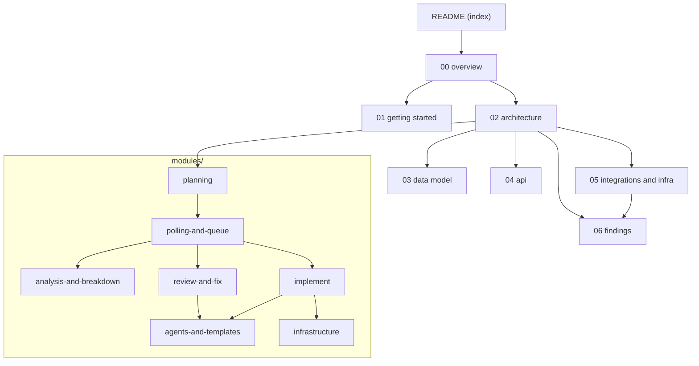

# ai-runner documentation

A guided tour of the `ai-workflow` repository for a new developer. Written from the code, with diagrams (Mermaid, so they render in GitHub, GitLab and VS Code).

## Table of contents

| Doc | What you get |
| --- | --- |
| [00-overview](00-overview.md) | What the system does, tech stack, context and architecture diagrams, repository map |
| [01-getting-started](01-getting-started.md) | Prerequisites, secrets, run modes, tests, every `repos.yml` setting, local setup diagram |
| [02-architecture](02-architecture.md) | Layers, design rules, auth and trust flow, error handling, poll-to-job lifecycle |
| [03-data-model](03-data-model.md) | SQLite tables (ER diagram), state kept in GitBucket (markers, labels), state diagrams |
| [04-api](04-api.md) | CLI modes, GitBucket REST calls, Copilot/git command lines, labels and `@ai` as the user interface |
| [05-integrations-and-infra](05-integrations-and-infra.md) | External services, workers and queue, deployment (there is no pipeline), ops cheat sheet |
| [06-findings](06-findings.md) | Risks, tech debt, missing tests, and open questions, with severity |

### Modules (one per workflow area)

| Doc | Covers |
| --- | --- |
| [modules/planning](modules/planning.md) | `JobPlanner`, the `@ai` thread rules (`AtAiThread`), labels. The brain of the runner. |
| [modules/polling-and-queue](modules/polling-and-queue.md) | `Poller`, `JobQueue`, `JobWorker`. Scheduling, retries, failure reports. |
| [modules/analysis-and-breakdown](modules/analysis-and-breakdown.md) | Workflows 1 and 1b: questions, SPEC, sub-issues, sequencing. |
| [modules/implement](modules/implement.md) | Workflow 2 and `AgentSession`: code, checks, fix rounds, PR. |
| [modules/review-and-fix](modules/review-and-fix.md) | Workflows 3 and 3b: AI review comment, `@ai` review fixes. |
| [modules/agents-and-templates](modules/agents-and-templates.md) | The Markdown contract between the runner and Copilot agents. |
| [modules/infrastructure](modules/infrastructure.md) | GitBucket client, Copilot runner, git, processes, workspace, SQLite. |

Older notes in the repo: `../README.md` (user guide), `../CLAUDE.md` (rules for AI assistants), `../CONTEXT.md` (glossary of the `@ai` thread words).

## Where to start (reading order)

1. [00-overview](00-overview.md) - 10 minutes. Know what problem it solves.
2. `../README.md` "How a human drives it" - see the product from the user's side.
3. [02-architecture](02-architecture.md) - the Poll -> Plan -> Queue -> Job idea and the layer rules.
4. [modules/planning](modules/planning.md) - **the** file to understand: `Core/JobPlanner.cs`.
5. [modules/polling-and-queue](modules/polling-and-queue.md), then the workflow module you will change.
6. [01-getting-started](01-getting-started.md) - run `--once --dry-run` against a test repo, and `dotnet test`.
7. [06-findings](06-findings.md) before you start changing risky areas (security, config).

## Diagram: docs map

*Start at the index, read the overview, then architecture. From architecture, go down the modules in the order a job runs: plan, queue, then each workflow. Findings sit at the end.*

## Glossary

| Term | Meaning |
| --- | --- |
| **ai-runner** | The .NET Worker Service in `src/AiRunner`. |
| **GitBucket** | The self-hosted Git server with a GitHub-compatible REST API (`/api/v3`). |
| **Copilot CLI** | GitHub's command-line agent. The runner calls `copilot -p --agent <name>`. |
| **Premium request** | A unit of Copilot quota. Each Copilot call can spend one. |
| **Agent** | A Markdown file with rules for one kind of Copilot run (`agents/*.agent.md`). |
| **Skill** | A Markdown checklist an agent can read (`skills/*/SKILL.md`). |
| **Template** | The exact output format an agent must write (`templates/*.md`). |
| **Poll / Plan / Queue / Job** | The four steps of the main flow. See [02-architecture](02-architecture.md). |
| **PlanDecision** | The planner's answer: a `JobRequest` or a reason to skip. |
| **Job key** | `Type:repo#number`. Only one pending job per key. |
| **Fingerprint** | `updated_at` + labels of an issue; unchanged = comments are not read again. |
| **Scope label** | `ai` (config `scopeLabel`). Puts an issue or PR in the runner's scope. |
| **`@ai`** | Text a human writes in a comment to ask the runner to act. |
| **Bot comment** | A comment the runner wrote, found again by `<!-- ai-runner -->`. |
| **Block** | A marked section in a bot comment: `ANALYSIS`, `SPEC`, `REVIEW`, `REVIEW_FIX`. |
| **Thread / Trigger / Reply** | The bot replies of one block kind, the newest unanswered `@ai` comment, and the bot comment that answers it. See `../CONTEXT.md`. |
| **Read-up-to** | Newest comment id a job had read when it replied (stored as `context-upto`). |
| **Local cursor** | `issue_state.last_handled_comment` in SQLite; covers jobs that failed before replying. |
| **Round** | One analysis reply on an issue (capped by `maxAnalysisRounds`). |
| **SPEC** | The final plan comment written when an analysis is `ready`. |
| **Breakdown** | Splitting a complex issue into ordered sub-issues. |
| **Sub-issue** | An issue created by the breakdown, built on `feat/issue-N` as `ai/issue-N-K`. |
| **Parent** | The complex issue that was split (`ai:parent`). |
| **Feature branch** | `feat/issue-N`, where sub-issue PRs are merged before the final PR. |
| **Fix round** | An extra Copilot run started by the runner when checks or the output file are wrong (`implement.maxFixRounds`). |
| **Review fix** | Workflow 3b: Copilot changes a PR's branch after an `@ai` comment. |
| **WIP PR** | A PR opened with a red build/test/lint, titled `[WIP - checks failing] ...`. |
| **Scoped review** | Only PRs with label `ai` or opened by the runner are reviewed (`review.scope: scoped`). |
| **Quiet** | A job outcome that leaves no row, no log, no cost entry (nothing was needed). |
| **Guard rail** | A restriction that lowers risk but is not a security boundary (e.g. shell allow-list). |
| **Workflow 4** | The GitHub mirror / cloud agent. Not built. |
