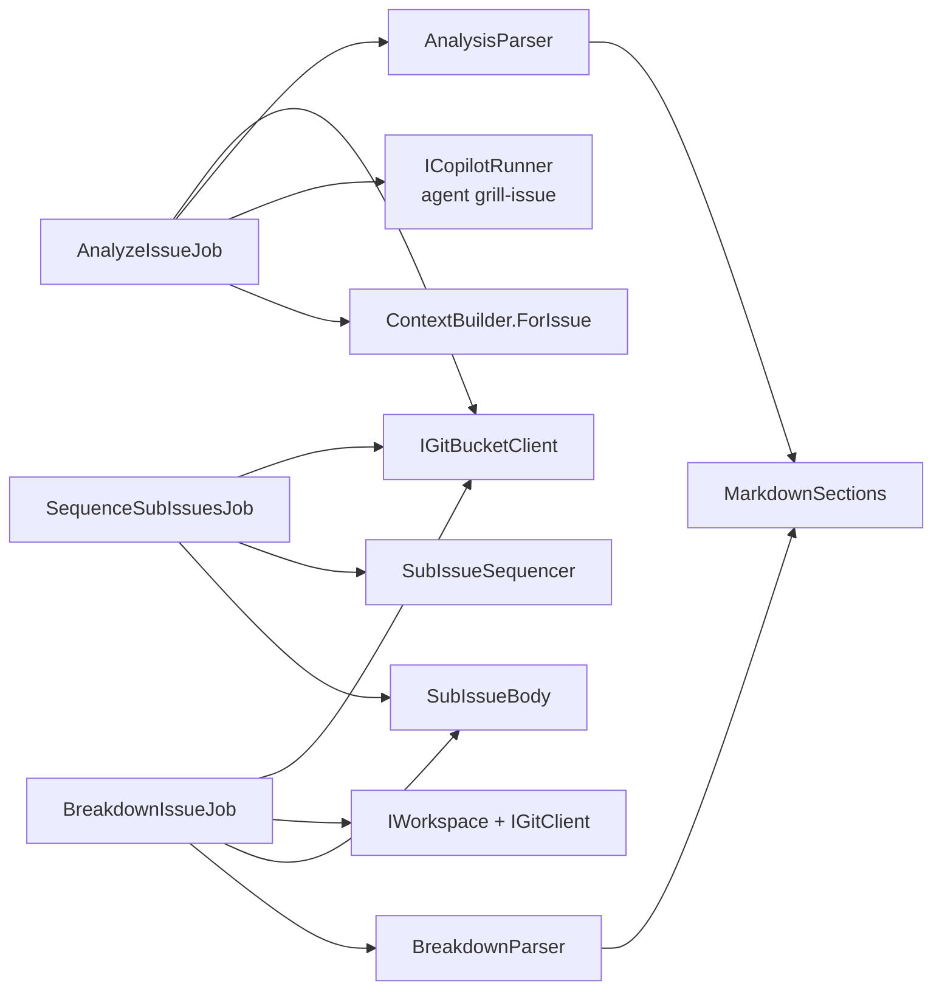
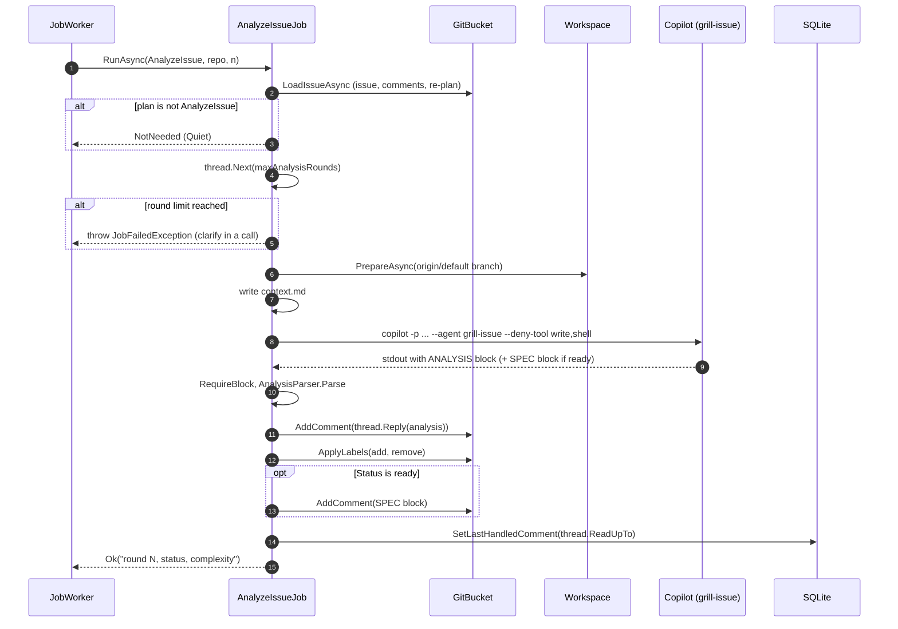
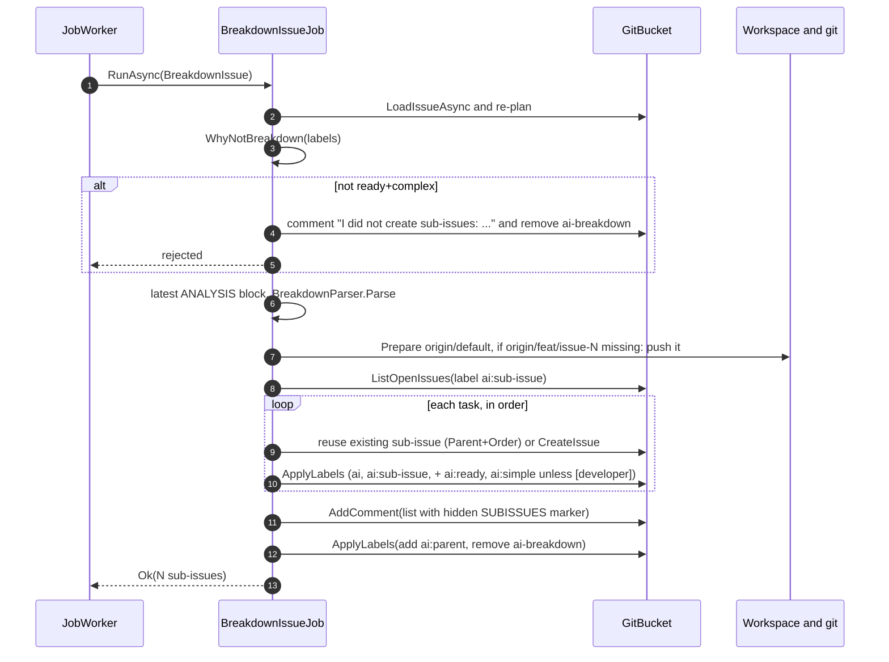
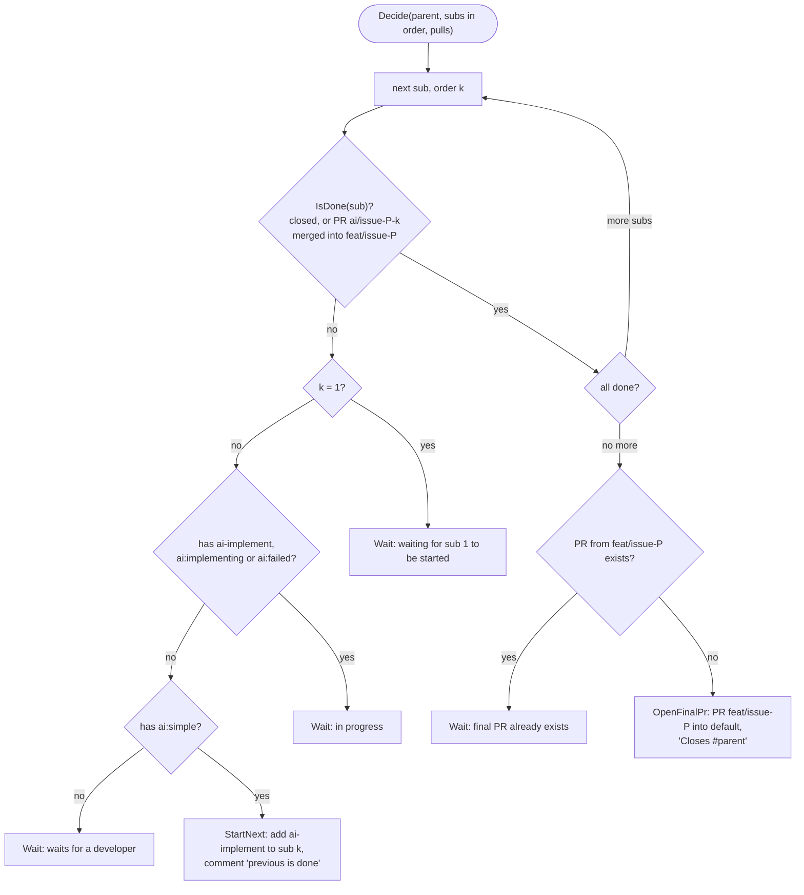

# Module: Analysis and breakdown (Workflows 1 and 1b)

## Purpose

Turn a vague issue into something safe to build. Copilot (read-only) asks questions and writes a plan; when the human has answered everything, it also writes a SPEC. For a complex issue, the runner splits the plan into ordered sub-issues and opens them one by one.

## Components

*Analysis is the only one of the three that runs Copilot. Breakdown and sequencing are API-only; they read the breakdown the analysis already wrote.*

## Key files

| File | One line |
| --- | --- |
| `Jobs/AnalyzeIssueJob.cs` | Workflow 1. Builds `context.md`, runs `grill-issue`, validates, posts analysis (+ SPEC), sets labels. |
| `Jobs/BreakdownIssueJob.cs` | Workflow 1b step 1. Creates `feat/issue-N` and sub-issues, posts the parent comment with the hidden list. |
| `Jobs/SequenceSubIssuesJob.cs` | Workflow 1b step 2. Every poll for `ai:parent` issues: start next sub-issue or open the final PR. |
| `Core/AnalysisParser.cs` | Reads `**Status:**`, `**Complexity:**` and `**Components affected:**` -> labels to add/remove, components. |
| `Core/SpecParser.cs` | Checks the SPEC technical plan table (`Step | Component | File | Change`). |
| `Core/BreakdownParser.cs` | Reads the 6-column table (with `Component`) and `Shared contract:`. |
| `Core/SubIssueBody.cs` | Builds/parses sub-issue bodies, the hidden `SUBISSUES` list and `IsDone`. |
| `Core/SubIssueSequencer.cs` | Pure decision: `Wait`, `StartNext`, `OpenFinalPr`. |
| `Core/ContextBuilder.cs:ForIssue` | `context.md` for the agent (issue, then comments oldest first, bot comments tagged `[bot]`). |
| `agents/grill-issue.agent.md`, `skills/grill-me/SKILL.md` | The agent rules. |
| `templates/analysis.md`, `templates/spec.md` | Output formats. |

## Flow 1: an analysis round

*Source: `Jobs/AnalyzeIssueJob.cs:26-67`. Everything is validated **before** the first post, so a bad answer is never half-applied (comment at line 53). The SPEC is a separate comment so the implement job can find it by marker.*

### Label outcome (from `AnalysisParser.Parse`)

| Status | Complexity | Add | Remove |
| --- | --- | --- | --- |
| `questions-open` | any | `ai:questions-open` | `ai:ready`, `ai:simple`, `ai:complex` |
| `ready` | `simple` | `ai:ready`, `ai:simple` | `ai:questions-open`, `ai:complex` |
| `ready` | `complex` | `ai:ready`, `ai:complex` | `ai:questions-open`, `ai:simple` |

## Flow 2: breakdown

*Source: `Jobs/BreakdownIssueJob.cs:23-66`. Safe to retry: an existing feature branch is kept and existing sub-issues are matched by the `Parent:` / `Order:` header in their body, not by title.*

## Flow 3: sequencing decision

*Source: `Core/SubIssueSequencer.cs:18-42`. Sub-issue 1 is always started by a human (or by the breakdown when `autoStartFirstSubIssue: true`).*

## Business rules and edge cases

- **Analysis rounds**: capped by `limits.maxAnalysisRounds` (5). At the cap the job fails on purpose with advice to clarify in a call.
- **Max 7 questions**, Given/When/Then criteria, "simple" = up to 5 production files (test files, docs, lock files don't count). These live in the agent file (`agents/grill-issue.agent.md`), not in C#.
- **Breakdown table is strict**: exactly 6 cells (`# | Component | Title | Scope | Touches | Depends on`), rows numbered 1..N in order, `Depends on` may only name earlier rows, title/scope not empty, `Shared contract:` line required (`BreakdownParser.cs`). Violations fail the analysis job (a ready complex analysis is checked before it is posted) with the exact reason. If an unreadable breakdown still reaches `ai-breakdown`, the job comments the reason, removes the label and asks for a new analysis (`@ai`); it does not add `ai:failed`.
- **`[developer]` prefix** in a title: that sub-issue does **not** get `ai:ready`/`ai:simple`. The body tells a human to build it. The sequencer then waits at it ("waits for a developer") until someone closes it (a PR counts only from branch `ai/issue-
-<o>` into `feat/issue-
`).
- **Sub-issue body header** (`Parent`, `Order`, `Base branch`, `Depends on`) is what the implement job reads (`SubIssueBody.Parse`). A body with `Parent:` but no `Order:` throws `FormatException`.
- **Final PR** is opened once; the parent comment and PR body list each sub-issue PR. A sub-issue closed without a runner PR is shown as "closed without a runner PR".
- **Sub-issues that stop**: a too-big implement run, or a sub-issue PR closed without a merge, leaves the sub-issue with `ai:failed` and a comment. The sequencer waits until a human removes `ai:failed` (or builds it by hand and closes it).

## Dependencies

- Uses: `IGitBucketClient`, `IWorkspace`, `IGitClient`, `ICopilotRunner`, `IStateStore`, Core parsers.
- Used by: `JobWorker` (via `JobFactory`). Implement reads the parent's hidden list for ordering ([implement](implement.md)).

## Gotchas

- `BreakdownIssueJob` finds existing sub-issues with `ListOpenIssuesAsync(label ai:sub-issue)` across the **whole repo** (not per parent), then filters by body. Closed sub-issues are not in that list, so a retry after closing one would create a duplicate for that order.
- The parent's list is stored in a **hidden comment line**. If a human edits or the bot comment is lost, `SequenceSubIssuesJob` throws "no sub-issue list" and the parent gets `ai:failed`.
- `SequenceSubIssuesJob` is planned on **every poll** for every `ai:parent` issue and costs several API calls each time (issue, comments, each sub-issue, open + closed PR lists). The job then usually ends as Quiet. See [06-findings](../06-findings.md).
- The analysis SPEC is a **separate comment**, posted after the analysis comment. If the SPEC post fails, the analysis comment and labels are already in place (no rollback).
- An analysis posted for a `ready` status but with no SPEC block fails the job *before* posting (`RequireBlock`), so that case is clean.
