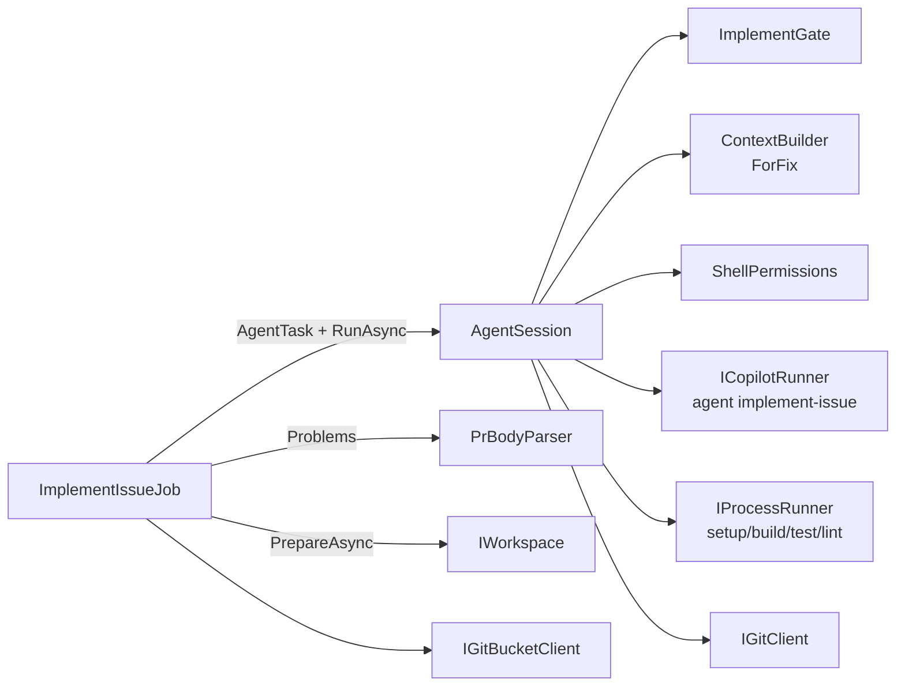
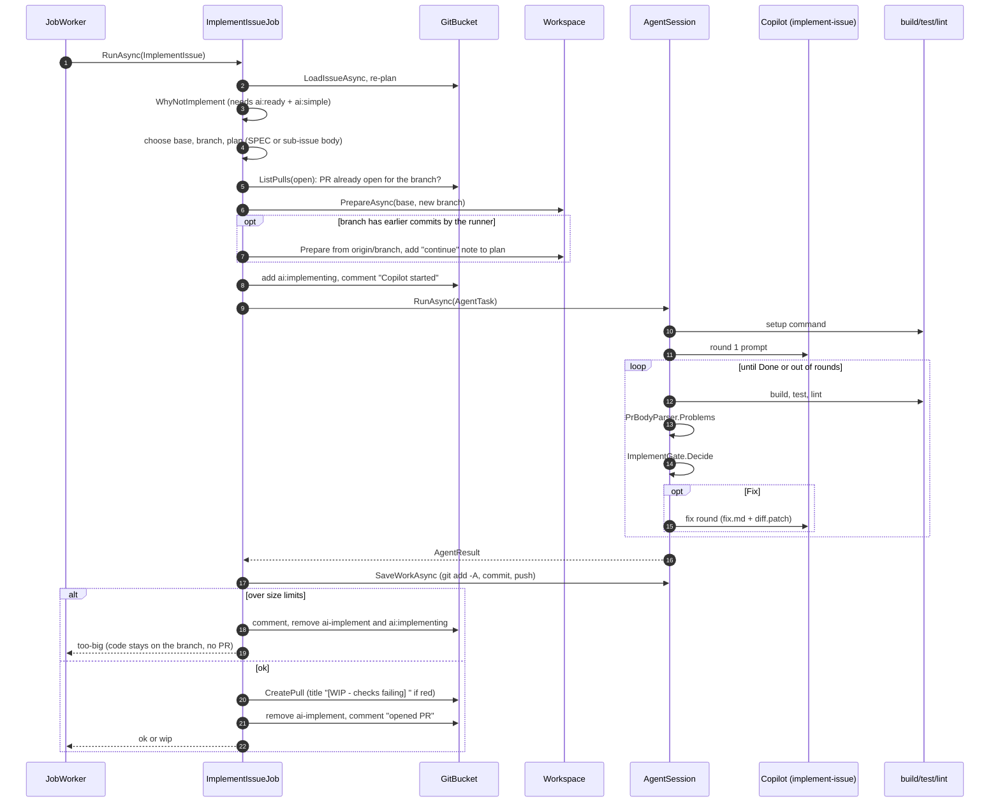
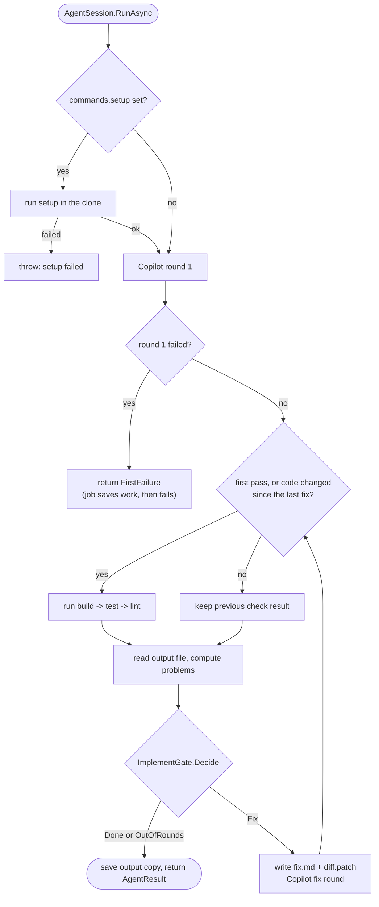

# Module: Implement and the agent session (Workflow 2)

## Purpose

Let Copilot write code for one **simple, analyzed** issue, then make sure the result is good enough to open as a PR. The agent does the developer stages itself (understand, implement, verify, review, write the PR text). The runner is the **safety net**: it re-runs the checks, checks the PR text, sends problems back for a limited number of fix rounds, enforces size limits, and does all git work. The agent never runs git.

`AgentSession` is the loop and is **shared with the review fix** ([review-and-fix](review-and-fix.md)).

## Components

*The job knows about issues, branches and PRs. `AgentSession` knows about rounds, checks and the `.git/config` guard. Neither knows how Copilot or git are started.*

## Projects and components

- **Target component.** A sub-issue names it in its `Component:` line; a simple issue gets it from its latest analysis (`Components affected`, exactly one). Data from before components existed names none: a project with one code component uses that one, otherwise the job fails and asks for the analysis to run again (`JobSupport.TargetOfIssue`, `TargetComponent`). The branch, the work and the PR are in the target component's repo; the issue, its labels and its comments stay in the issues repo.
- **Scope guard.** After every agent round (and before the checks) `AgentSession` asks each clone of the project for its changed paths and undoes what the agent may not change: all edits in other repos, edits outside the target component folder, and files matching `never_edit` (`Core/ScopeRules`, `IGitClient.ChangedPathsAsync` and `RestorePathsAsync`). The undone paths are listed in the PR body ("Changes undone by ai-runner") and, if a fix round happens anyway, in `fix.md`. An undo alone does not start a fix round.
- **PR link.** The PR body ends with `Issue: owner/repo#n` and never has `Closes`. The runner closes the issue after the merge (`FinishIssueJob`; sub-issues by `SequenceSubIssuesJob`).
- **Previous sub-issue.** "Is the previous sub-issue merged" looks at the PRs of the repo of the previous sub-issue's component.

## Key files

| File | One line |
| --- | --- |
| `Jobs/ImplementIssueJob.cs` | Whole workflow: gate checks, branch choice, continue-from-saved-work, run session, size limits, PR, labels. |
| `Jobs/AgentSession.cs` | Setup, agent round 1, checks, fix rounds, `.git/config` guard, `SaveWorkAsync` (commit + push). |
| `Core/ImplementGate.cs` | `Decide(...)` -> `Done` / `Fix` / `OutOfRounds` / `NoProgress`; `Fingerprint`; `TimeForAnotherRound`. |
| `Core/PrBodyParser.cs` | Lists problems in `PR_BODY.md` (headings, criteria count, unchecked criteria without reason). |
| `Core/ShellPermissions.cs` | Turns `dotnet build X.sln` into `shell(dotnet:*)`. Launchers (`cmd`, `powershell`, `bash`...) keep the exact command. `git` yields nothing. |
| `Core/ContextBuilder.cs` | `PlanFromSpec`, `PlanFromSubIssue`, `ForFix` (writes `fix.md`). |
| `Infrastructure/Workspace.cs` | Clean checkout, template copy, `.git/info/exclude` for runner files. |
| `agents/implement-issue.agent.md`, `agents/code-reviewer.agent.md`, `skills/implement-checklist/` | What the agent is told. |
| `templates/pr-body.md` | PR text format. |

## Flow 1: implement an issue (end to end)

*Source: `Jobs/ImplementIssueJob.cs:36-162`. If the job throws after `ai:implementing` was added, a `catch` removes that label so the planner can start again once a human clears `ai:failed` (lines 104-113).*

## Flow 2: the agent session loop

*Source: `Jobs/AgentSession.cs:48-176`. After a failed **build**, test and lint are skipped (they would only repeat the errors). If build passes, test and lint both run, so one fix round gets every failure.*

### `ImplementGate.Decide` truth table (`Core/ImplementGate.cs:24-27`)

| Checks pass? | PR_BODY problems | `canRunAgain` and fix rounds left? | Result |
| --- | --- | --- | --- |
| yes | 0 | - | `Done` |
| any | any | no (last Copilot call failed, too little time, or `fixRoundsUsed >= max`) | `OutOfRounds` |
| yes | > 0 | yes, but a fix round was already used | `OutOfRounds` (only **one** round for a PR_BODY-only problem) |
| no | any | yes, a fix round was used and the round ended like the one before (same `Fingerprint`) | `NoProgress` (the PR opens like `OutOfRounds`; the round line says "no progress") |
| no, or yes with 0 rounds used | > 0 or failing | yes | `Fix` |

`TimeForAnotherRound(left, perCall)` is `left >= perCall * 2`: a round needs Copilot plus checks, each up to the per-call timeout (`ImplementGate.cs:34`).

## Business rules

- **Who may be implemented**: only issues with `ai:ready` **and** `ai:simple`. Otherwise the job comments `I did not start: ...` and removes `ai-implement` (`RejectAsync`).
- **Normal issue**: base = default branch, branch = `ai/issue-N`, plan = SPEC comment (missing SPEC = job fails: "Run the analysis until Status is ready").
- **Sub-issue**: base = `feat/issue-P`, branch = `ai/issue-P-K`, plan = the sub-issue body. Sub-issue K must wait until K-1 is done (`PreviousSubIssueNotDoneAsync`). If it is not, the label is removed and the sequencer adds it back later.
- **Refuse the base branch** as a work branch (`ImplementIssueJob.cs:69`).
- **Existing PR for the branch**: the job comments and swaps `ai-implement` for `ai:implementing` (`:73-81`).
- **Continue earlier work**: if `origin/<branch>` has commits not in base and *all authors' e-mails equal `git.userEmail`*, the work folder is re-created from that branch and the plan gets a "continue" note. If anyone else committed, the job fails ("Someone may be working on it").
- **Size limits**: after the push, `Limits.Allows(files, lines)` (`maxChangedFiles` 15, `maxDiffLines` 800). Over the limit = no PR, a comment, code stays on the branch.
- **Red checks**: PR still opens, title prefixed `[WIP - checks failing] `, body begins with a WIP notice (`PullBody`).
- **Round 1 Copilot failure**: whatever was written is committed and pushed to the branch, the job fails with "partial work saved on branch ... (no PR)". A later retry continues from it.
- **Fix-round Copilot failure**: not fatal. The PR is opened from what exists; the round line says `Copilot failed (...)`.
- **Time**: job timeout = `implementTimeoutMinutes * (2 + 2 * maxFixRounds) + 10` using the **largest** `maxFixRounds` across all repos (`AgentSession.JobTimeout`, `:44-46`). With 45 min and 2 rounds this is 280 min.
- **No code change in a fix round**: if `git diff` equals the one before the fix round, the old check results are reused (`:135-138`).
- **PR_BODY.md** must have `What changed`, `How it was tested`, `Acceptance criteria`, `Open points`. Criteria count must equal the numbered criteria in plan.md; unchecked ones need ` - reason`. Heading levels `##`/`####` are auto-fixed to `###` (`MarkdownSections.HeadingsToLevel3`).

## Where the safety checks are

| Guard | Code | What it prevents |
| --- | --- | --- |
| Agent has no git | `DenyTools = shell(git), shell(git:*), write(.ai-workflow)` (`AgentSession.cs:200`) | Agent changing history or branches |
| Allow list from config | `AllowTools` = `write` + `ShellPermissions.For(each command)` + `allowShell` (`:195-197`) | Agent silently blocked by a pattern that is too narrow |
| `.git/config` hash check | `GuardGitConfig` after every agent run and every check (`:71-77`) | A run that changes git config so git later runs agent code or leaks the token. On change: delete the clone, push nothing. |
| Non-forced push | `GitClient.PushAsync` | Overwriting someone's work |
| Runner files excluded | `Workspace.RunnerFiles` in `.git/info/exclude` | Committing `plan.md`, `PR_BODY.md`, `.ai-workflow/` etc. |
| `--no-verify` commit and hooks off | `GitClient.CommitAsync`, `core.hooksPath` | Agent-written hooks running |

## Dependencies

- Uses: `IGitBucketClient`, `IWorkspace`, `IGitClient`, `ICopilotRunner`, `IProcessRunner`, `IStateStore`, `RunnerConfig`.
- Used by: `JobWorker`. `AgentSession` is also used by `FixReviewJob`.

## Gotchas

- **Process behaviour**: commands run through `cmd.exe /d /s /c "<cmd>"` on Windows, so a command with quotes or `&&` is interpreted by cmd, not by bash (`ProcessSpec.Shell`).
- **Setup runs before the `.git/config` fingerprint is taken** (`AgentSession.cs:59-67`). A setup command that changed `.git/config` would not be noticed.
- **Check output is the tail only** (`Tail(3000)` in `fix.md`, `Tail(2000)` in the PR body). Full output is in `round-N-check-M.txt`.
- **Labels**: `ai-implement` is removed only on PR open or rejection. A failed job leaves `ai-implement` and adds `ai:failed`; the planner skips on `ai:failed` until a human removes it.
- **`ImplementIssueJob` pushes first, judges size second.** Oversize code is on the remote branch even though no PR is opened.
- **Tests that guard this**: `tests/AiRunner.Tests/Jobs/ImplementIssueJobTests.cs` (21), `GuardRailTests.cs` (8), `Core/ImplementCoreTests.cs` (22).
