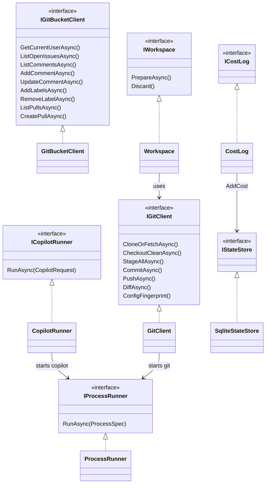
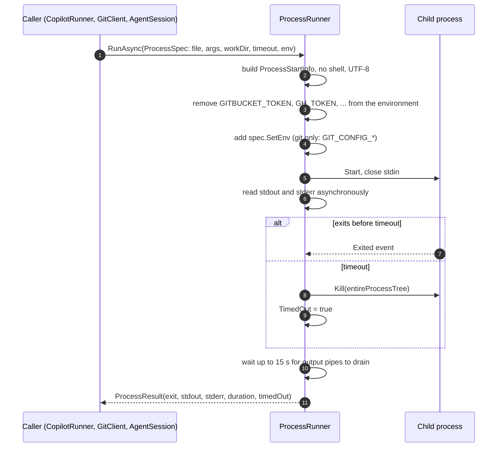
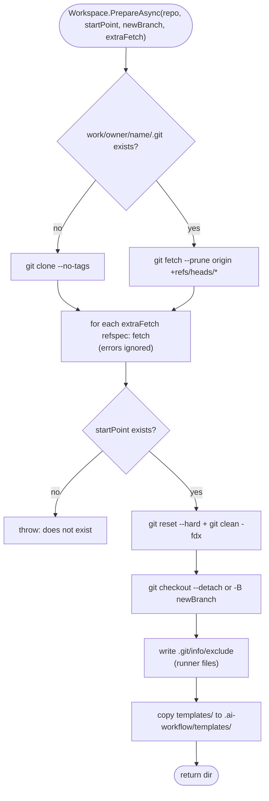

# Module: Infrastructure (`Infrastructure/`)

## Purpose

Every side effect of the runner lives here, behind a small interface. No business decisions. If GitBucket, Copilot or git behave oddly, the fix goes in exactly one class here.

## Components

*Every box on the left is an interface the jobs depend on. `ProcessRunner` is the only class that starts a process, so the "no secret in child env" rule is enforced in one place.*

## Key files

| File | One line |
| --- | --- |
| `GitBucketClient.cs` | REST client. ASCII cleaning, bot marker on every comment, paging, error mapping (`GitBucketException`). |
| `CopilotRunner.cs` | Builds the `copilot -p` command line from a `CopilotRequest`; `LooksLikeQuotaError`. |
| `ProcessRunner.cs` | Starts a process with no stdin, captures output, kills the whole tree on timeout, strips secret env vars. |
| `GitClient.cs` | git commands with credentials and hardening in `GIT_CONFIG_*` env vars. |
| `Workspace.cs` | One persistent clone per repo, reset + clean before each job, copies templates, writes `.git/info/exclude`. |
| `SqliteStateStore.cs` | The schema and all SQL (see [03-data-model](../03-data-model.md)). |
| `JobLog.cs` | `JobLog` (run folders, cleanup) and `JobRun` (save files, `Info`, `Deadline`, `TimeLeft`). |
| `CostLog.cs` | One row per job to SQLite and `logs/cost.csv`. Never throws. |
| `AgentInstaller.cs` | Copies `agents/` and `skills/` to `~/.copilot/`. |
| `RunnerIdentity.cs` | Bot login (from `GET /user`) and the git secret. |
| `FileSystem.cs` | `DeleteDirectory` that clears read-only attributes (git objects on Windows). |

## Flow: how a child process is started safely

*Source: `Infrastructure/ProcessRunner.cs:63-122`. It waits on the `Exited` event, not `WaitForExitAsync`, because a grandchild (build server, test host) may keep the output pipes open forever.*

## Flow: preparing the work folder

*Source: `Infrastructure/Workspace.cs:41-61` and `GitClient.cs:46-65`. `git clean -fdx` removes ignored folders such as `node_modules`, which is why `commands.setup` exists.*

## Business rules / quirks handled here

| Quirk | Where | Handling |
| --- | --- | --- |
| Non-ASCII text -> HTTP 500 | `GitBucketClient` + `Core/AsciiSanitizer` | Map common symbols (dashes, quotes, arrows), drop accents (Vietnamese becomes "tieng Viet"), drop emoji. |
| All comments need the bot marker | `GitBucketClient.WithMarker` | Adds `<!-- ai-runner -->` and `**[ai-runner]**` unless the marker is already there. |
| `since` ignored, no comment `DELETE`, no `/pulls/{n}/files` | `Poller`, `ReviewPullRequestJob` | See [04-api](../04-api.md). |
| PR create reply unreadable | `CreatePullAsync` | Take `number`, then `GET`. |
| Windows read-only git objects | `FileSystem.DeleteDirectory` | Clear attributes before delete. |
| Windows long paths | `GitClient` sets `core.longpaths=true` | `node_modules` paths pass 260 chars. |
| Output pipes held by grandchildren | `ProcessRunner` drain timeout (15 s) | Return what was read. |
| CSV open in Excel | `CostLog` | Catch `IOException`; the row is still in SQLite. |
| Copilot quota text unknown | `CopilotRunner.LooksLikeQuotaError` | Guess by words; failure message differs, job still fails. |

## Dependencies

- Uses: `Configuration` (paths, commands), `Core` models and `AsciiSanitizer`.
- Used by: `Jobs` and `Hosting` (through the interfaces).

## Gotchas

- **Single persistent clone per repo.** Jobs run one at a time, so this is safe. Running two runners on one machine with the same `paths.work` would corrupt it (not guarded).
- **`GitClient.RunAsync` builds the Basic auth header on every call** from `identity.Login:identity.GitSecret`. Both must be set before the first git call. `Program.cs:89` sets `Login` after `GET /user`, so any git use before that would send an empty login.
- **`PushAsync` uses `src:refs/heads/branch`** and never `--force`. A rejected push throws `InvalidOperationException("git push failed ...")`; `FixReviewJob` catches it, `ImplementIssueJob` does not (the generic handler reports it).
- **`SqliteStateStore` connections are pooled by default.** Tests pass `pooling: false` so the file can be deleted (`SqliteStateStore.cs:63`).
- **`CostLog` writes twice** (SQLite via `IStateStore.AddCost`, then the CSV). They can differ if the CSV is locked.
- **Time zone:** DB timestamps are UTC ISO-8601 (`"O"`). `job.log` lines use local `HH:mm:ss`. Job folder names use local time.
