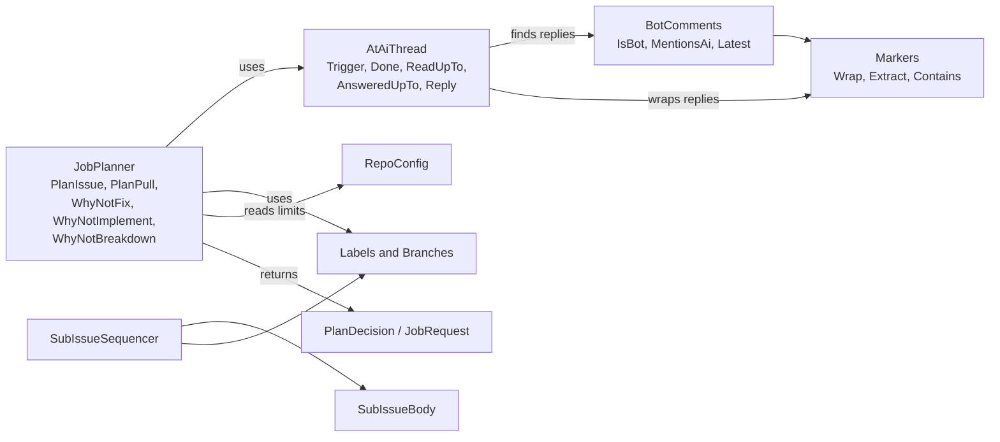
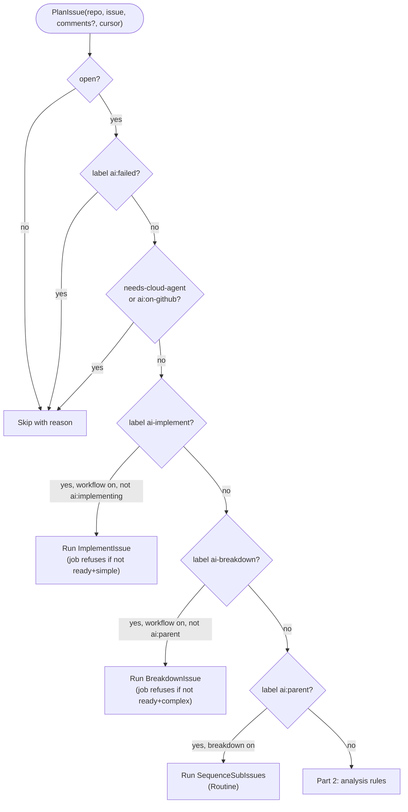
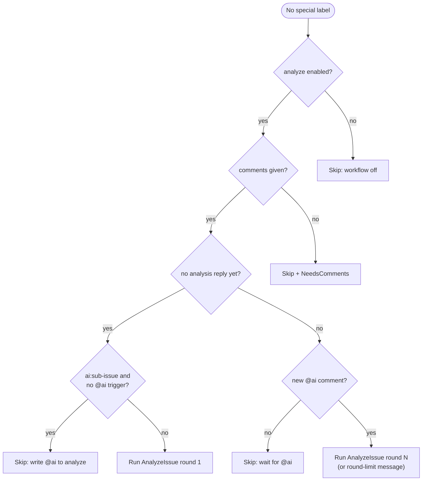
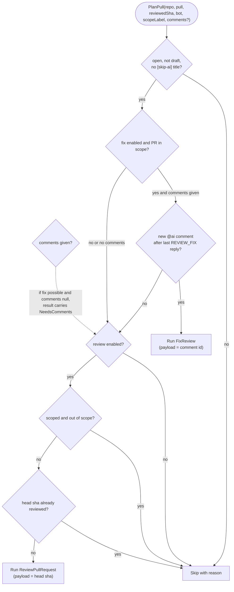
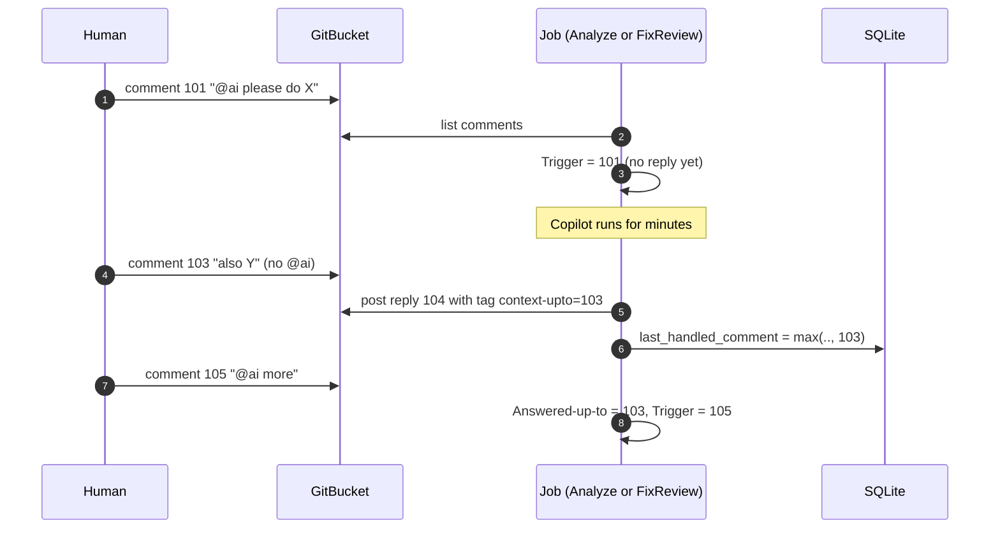

# Module: Planning (`Core/`)

## Purpose

Decide **what job, if any, an issue or PR needs**, and decide it the same way every time. This is the brain of the runner. It is pure code: it gets labels, comments and config, and returns a `PlanDecision`. The poller uses it to queue jobs. Every job uses it again on fresh data before it acts.

## Components

*`JobPlanner` decides per issue/PR. `SubIssueSequencer` decides the order of sub-issues (a separate decision with its own job).*

## Key files

| File | One line |
| --- | --- |
| `Core/JobPlanner.cs` | `PlanIssue` (label + comment rules), `PlanPull` (review vs fix), `WhyNotFix`, `WhyNotImplement`, `WhyNotBreakdown`. |
| `Core/JobRequest.cs` | `JobType`, `JobRequest` (with `Key`), `PlanDecision` (`Run`/`Skip`, `Routine`, `NeedsComments`). |
| `Core/AtAiThread.cs` | One block kind's replies plus the human comments around them: which `@ai` comment is new, how many replies exist, what a reply records. |
| `Core/BotComments.cs` | Recognises bot comments by `<!-- ai-runner -->` and `@ai` mentions in human comments. |
| `Core/Markers.cs` | `ANALYSIS`, `SPEC`, `REVIEW`, `REVIEW_FIX` block markers. Extract takes the **last** start marker. |
| `Core/Labels.cs` | All label names and the `Branches` helpers. |
| `Core/SubIssueSequencer.cs` | Which sub-issue to start next, or whether to open the final PR. |
| `Core/ImplementGate.cs` | Fix-round decision after the agent stops (see [implement](implement.md)). |
| `/CONTEXT.md` | The glossary of Thread, Trigger, Reply, Read-up-to, Answered-up-to, Local cursor, Round, Review fix. |

## Flow: planning an issue (part 1 - labels decide)

*Order matters: `ai:failed` and cloud labels win over everything; `ai-implement` wins over `ai-breakdown`, which wins over `ai:parent`, which wins over analysis. If a workflow is switched off for the repo, the answer is "Skip". Source: `Core/JobPlanner.cs:22-55`. ImplementIssue/BreakdownIssue are queued even when the labels are wrong, so the **job** can explain the refusal and remove the label (`JobPlanner.cs:33-36`).*

## Flow: planning an issue (part 2 - analysis rules)

*Source: `Core/JobPlanner.cs:55-77`. "Analysis reply" means a bot comment holding an `ANALYSIS` block (see the thread rules below).*

## Flow: planning a PR

*A review fix is planned **before** a review, so the review of the fixed head covers both (`JobPlanner.cs:93-128`). "In scope" = label `ai` on the PR, **or** head branch is `ai/*` / `feat/issue-*` and the PR author is the bot (`JobPlanner.cs:164-166`). Fix scope ignores `review.scope`: a fix pushes to the branch, so it is always the strict rule.*

## The `@ai` thread rules (`AtAiThread`)

The goal: decide which human comment is **new work**, without needing the database.

| Term | Meaning | Source |
| --- | --- | --- |
| Reply | Newest bot comment holding that block kind | `BotComments.Latest` |
| Read-up-to (`ReadUpTo`) | Max comment id seen when *this* reply is being built | `AtAiThread.cs:44` |
| Reply cursor | The tag `context-upto=<id>` of the last reply; if the tag is missing, the reply's own id | `AtAiThread.cs:26` |
| Local cursor | `issue_state.last_handled_comment` (SQLite) | passed in |
| Answered-up-to | `max(local cursor, reply cursor)` | `AtAiThread.cs:27` |
| Trigger | Newest human `@ai` comment with id > Answered-up-to | `AtAiThread.cs:50` |
| Requests since reply | Comments with id > **reply cursor only** (local cursor ignored on purpose) | `AtAiThread.cs:57` |

*The reply records 103 (the newest id read), not 101. Comment 103, written while Copilot ran, is still read as part of the next request because it is above the tag.*

Why the local cursor exists: a job that **failed before replying** leaves no tag. `FixReviewJob.OnFailed` writes the trigger id to `issue_state` so the poller does not retry on every poll (`FixReviewJob.cs:38-42`). `RequestsSinceReply` ignores that cursor so the failed request still reaches the next fix.

## Business rules and edge cases

- **Sub-issues are not analyzed unless asked.** `ai:sub-issue` with no `@ai` trigger is skipped (`JobPlanner.cs:66`).
- **Round limit.** `thread.Next(limit)` returns `(Done+1, Done >= limit)`. The planner still returns a job at the limit, and the job fails with an explanation (`AnalyzeIssueJob.cs:35-38`). That way the human sees *why* nothing more happens.
- **Fix refusals** (`WhyNotFix`, `JobPlanner.cs:135-148`): limit reached; PR head is the default branch; clone's `origin/<head ref>` is missing or not at the PR head sha (fork PR, deleted branch, or someone pushed meanwhile).
- **`Routine` decisions** (sequencing) log at Debug so the console stays quiet (`Poller.cs:99`).
- **`NeedsComments`** makes the poller read comments only when it must (one call), keeping cost low.

## Dependencies

Uses only `Configuration` POCOs. Used by: `Hosting/Poller`, `Jobs/JobSupport`, every job.

## Gotchas

- `BotComments.IsBot` only checks the **hidden marker**. A human who pastes a bot comment (marker included) is treated as the bot. The visible `**[ai-runner]**` tag is a human cue, not a security check.
- The planner trusts `pull.User.Login == bot` for "PR opened by the runner". If the bot account is shared with a human, scope widens.
- `Markers.Extract` takes the **last** start marker, so an agent that echoes the template and then fills it still works.
- `PlanIssue` runs the `ai-implement` branch **before** checking analysis comments, so an `ai-implement` label always produces a job (possibly a refusal) even if the issue was never analyzed.
