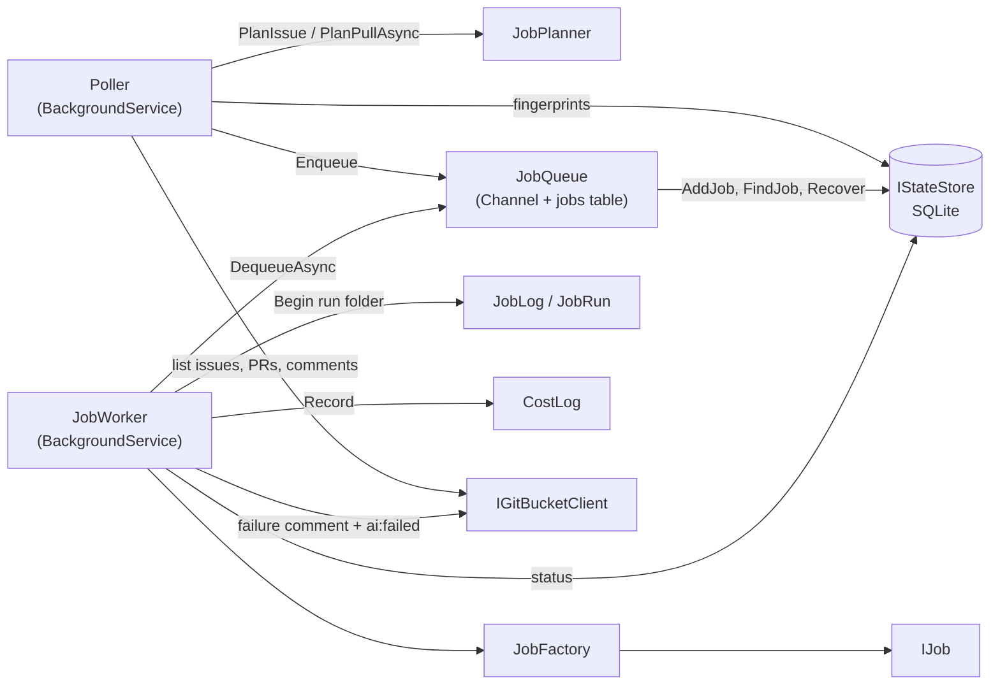
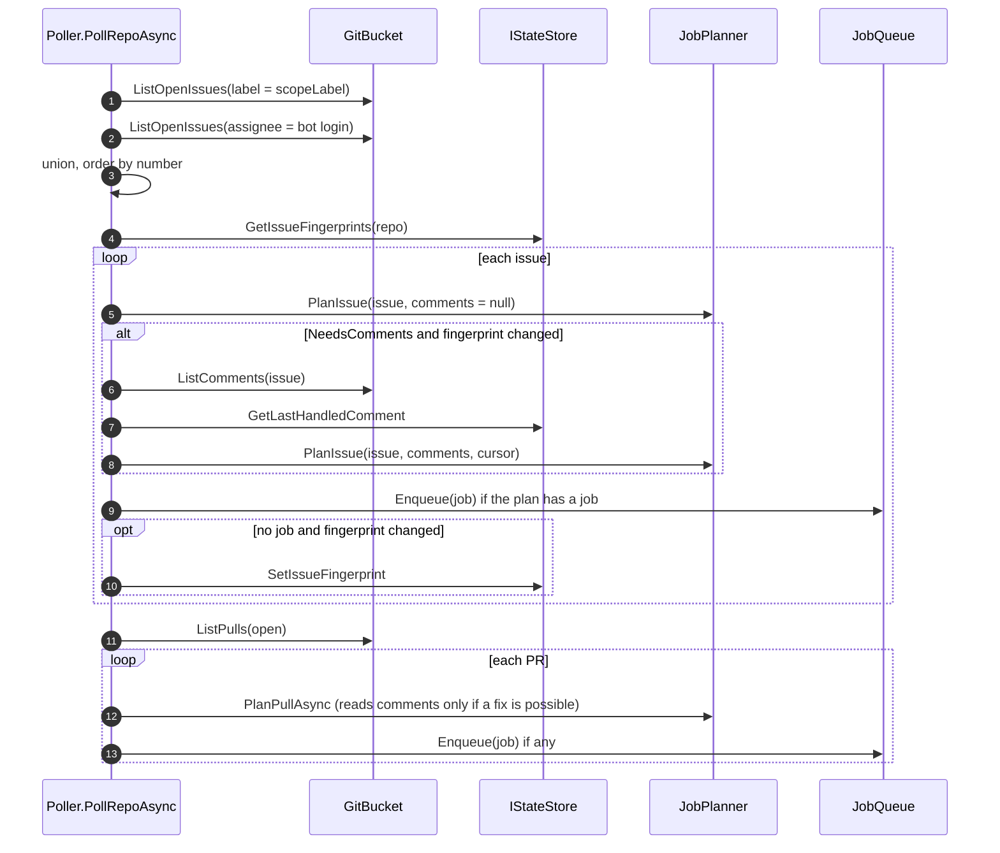
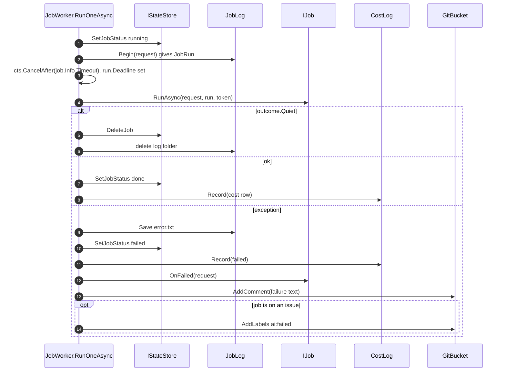
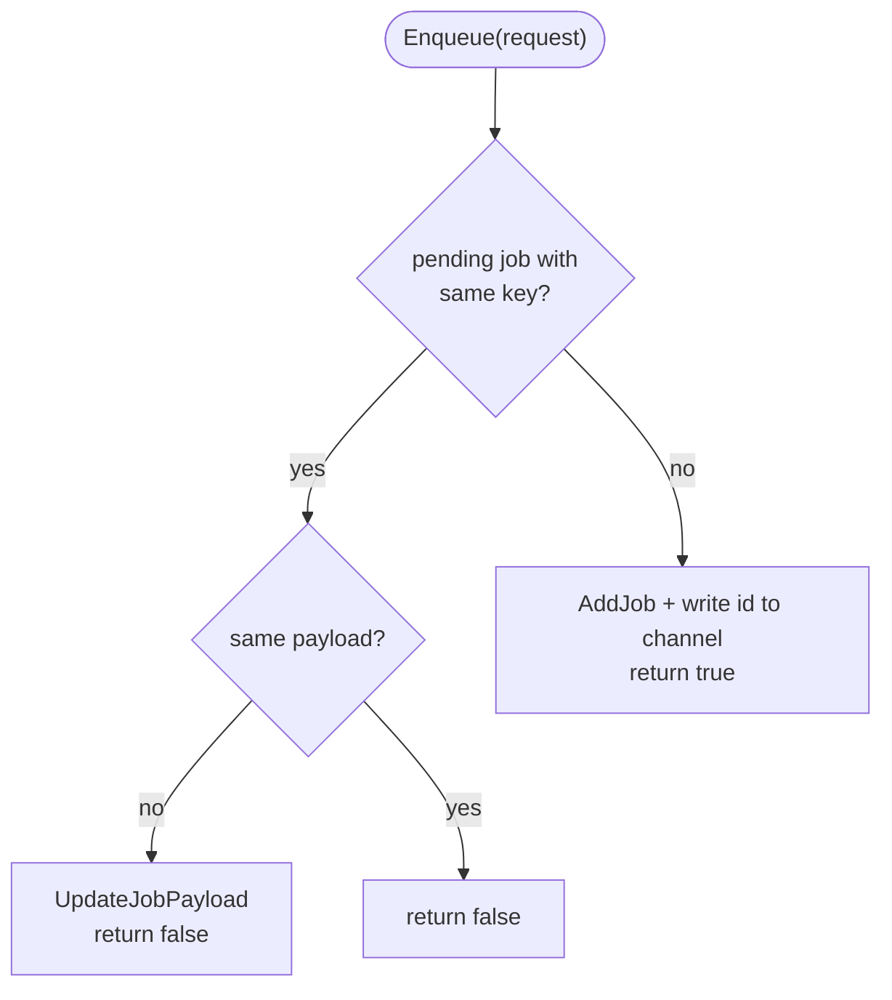

# Module: Polling, queue and worker (`Hosting/`)

## Purpose

Run the Poll -> Plan -> Queue -> Job loop: look at GitBucket on a timer, queue the work the planner asks for, and run it one job at a time with a timeout, a log folder, a cost row and a failure report. This layer only does **scheduling and lifetime**. It makes no business decision (rule in `CLAUDE.md`).

## Components

*Only `Poller` and `JobWorker` are `BackgroundService`s. `JobQueue` is a plain singleton shared by both.*

## Key files

| File | Role |
| --- | --- |
| `Hosting/Poller.cs` | Per repo: list in-scope issues and open PRs, plan, enqueue. Never writes to GitBucket. `DryRun` prints the plan only. |
| `Hosting/JobQueue.cs` | In-memory `Channel<long>` of job ids, backed by the `jobs` table. One `pending` row per key. `Recover()` at start. |
| `Hosting/JobWorker.cs` | Dequeue loop. Timeout, outcome handling, failure reporting. `DrainAsync` for `--once`. |
| `Hosting/LabelSetup.cs` | `--setup-labels`: creates every label from `Labels.All(scopeLabel)` in every repo. |
| `Hosting/CopilotSelfTest.cs` | `--copilot-test`: two Copilot calls to prove the child-process setup works. |
| `Jobs/IJob.cs` | `JobFactory` maps `JobType` to the registered `IJob`. |

## Main flow 1: one poll of one repo

*Source: `Hosting/Poller.cs:51-84`. The fingerprint is stored **only** when nothing is queued for the issue. If a job is queued and then fails silently (e.g. VPN down), the next poll plans it again instead of losing the request (class comment, `Poller.cs`).*

## Main flow 2: one job in the worker

*Source: `Hosting/JobWorker.cs:49-100`. Shutdown (`ct` cancelled) is handled first and leaves the job `running` so the next start re-queues it.*

## Flowchart: queue behaviour

*Source: `Hosting/JobQueue.cs:22-38`. A **running** job does not block a new pending one with the same key: the second run re-reads GitBucket and does nothing if the first already did the work (class comment).*

## Business rules

- **Scope guard.** An issue is in scope if it has `scopeLabel` or is assigned to the bot (`Poller.cs:54-58`).
- **Fingerprint** = `updated_at` (UTC, round-trip format) + `|` + sorted lower-case label names (`GbExtensions.Fingerprint`). Labels are included because GitBucket may not bump `updated_at` on a label change.
- **PRs have no fingerprint.** Each poll lists all open PRs; for PRs where a fix is possible it also lists the comments, so that is one extra call per such PR per poll (`Poller.cs:79-83`).
- **Worker timeouts** (`Info.Timeout`): analyze and review = Copilot timeout + 10 min; breakdown and sequencing = 10 min; implement and fix = `AgentSession.JobTimeout` (see [implement](implement.md)).
- **Failure text** (`JobWorker.cs:112-126`): `<Description> failed: <message>` + log folder path + how to retry. A PR job says "I will try again on the next commit" unless `JobInfo.Retry` is set (review fix says "write a new comment with @ai").
- **Recovery** (`JobQueue.Recover`): at worker start, `running` rows go back to `pending` once. A job interrupted twice is marked `failed` and reported ("stopped twice").
- **Cost row.** One per job that was not Quiet, including failures (`Record`).

## Dependencies

- Uses: `Core.JobPlanner`, `Infrastructure.IGitBucketClient`, `IStateStore`, `JobLog`, `ICostLog`, `Jobs.JobFactory`.
- Used by: `Program.cs` (registration, `--once` mode).

## Gotchas

- `Program.cs:71-76`: `Poller` runs as a hosted service in loop mode, **and with `--dry-run` alone the worker is not registered** - the loop keeps polling and printing. `--once --dry-run` is the one-shot variant.
- In `--once` mode `PollOnceAsync` finishes first, then `DrainAsync` runs everything queued, including jobs left from earlier runs.
- `Quiet` outcomes delete the log folder, so a "not needed" job cannot be debugged afterwards.
- `JobWorker` calls `job.OnFailed(request)` **inside** `ReportFailureAsync`, before the comment is posted. If GitBucket is unreachable the cursor/state is still updated, but no comment appears; a human sees the failure only in the console and `logs/`.
- Failure reporting uses `CancellationToken.None` so it still works when the job's token timed out.
- Interruption by Ctrl+C is detected by `ct.IsCancellationRequested`; a job timeout is a *different* token (`cts`), so the two are not confused (`JobWorker.cs:76-90`).
