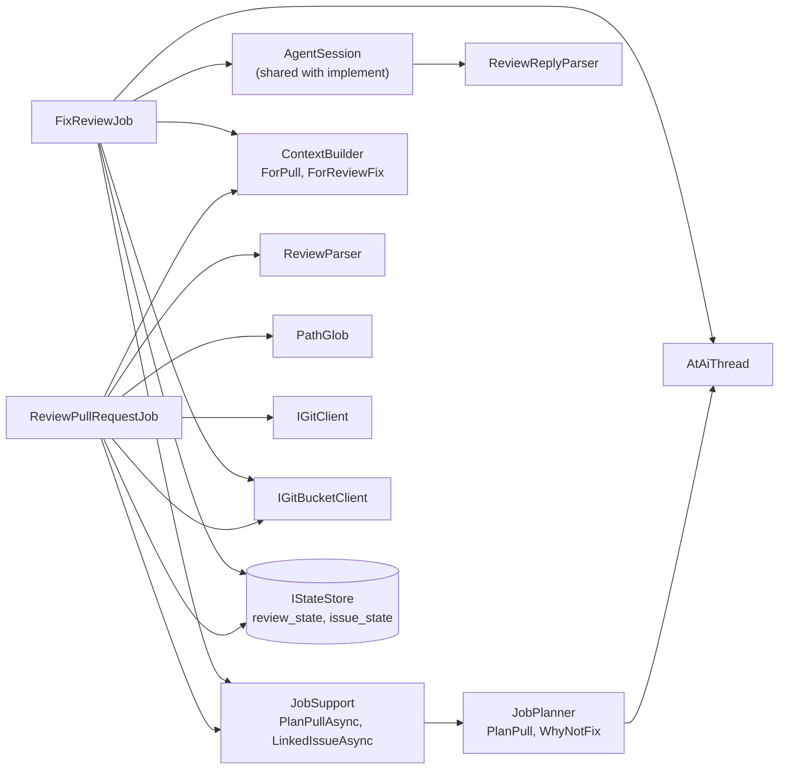
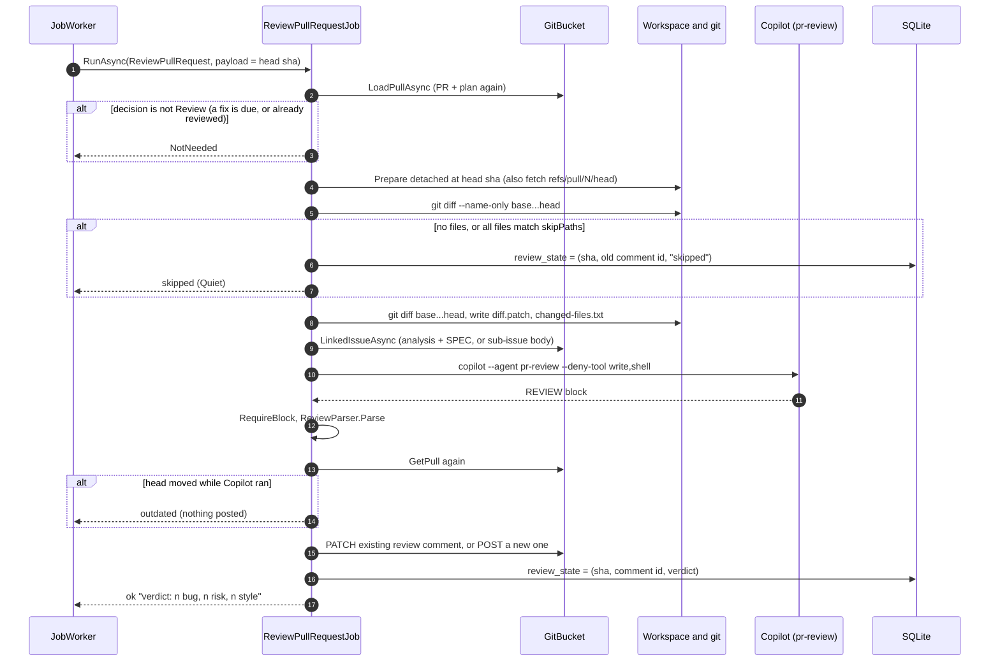
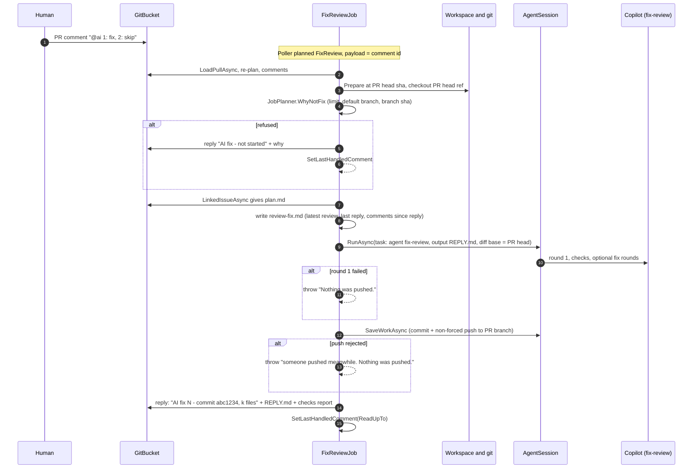
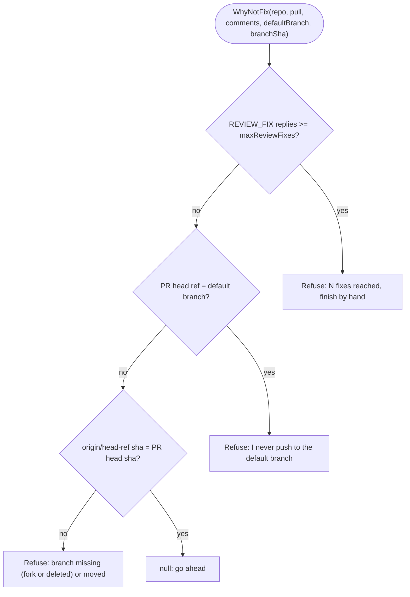

# Module: PR review and review fix (Workflows 3 and 3b)

## Purpose

- **Review (3)**: give each new head commit of an in-scope PR one first-pass AI review, as a single comment that is updated in place. It is advice for the human reviewer, never a gate.
- **Review fix (3b)**: when someone writes `@ai` on an in-scope PR, let Copilot change the PR's branch to answer the review and comments, then reply on the PR. The fixed head is then reviewed again automatically.

## Components

*Both jobs start by planning the PR through `JobSupport`. The review is read-only. The fix reuses the implement loop with a different `AgentTask`.*

## Key files

| File | One line |
| --- | --- |
| `Jobs/ReviewPullRequestJob.cs` | Workflow 3. Diff, context, `pr-review` agent, parse, post or update the review comment. |
| `Jobs/FixReviewJob.cs` | Workflow 3b. Refusal rules, context, `fix-review` agent via `AgentSession`, push, reply. |
| `Core/ReviewParser.cs` | Checks Verdict (`looks good`, `needs changes`, `needs discussion`) and Severity (`bug`, `risk`, `style`) in the findings table. |
| `Core/ReviewReplyParser.cs` | Checks `REPLY.md`: headings `Replies`, `How it was tested`, `Open points`, and at least one `- ` reply line. |
| `Core/PathGlob.cs` | Small glob matcher for `review.skipPaths`. |
| `Core/ContextBuilder.cs` | `ForPull` (context.md), `ForReviewFix` (review-fix.md), `PlanForReviewFix` (plan.md), `LinkedIssue` (finds `Closes #n`). |
| `agents/pr-review.agent.md`, `agents/fix-review.agent.md`, `skills/review-checklist/` | Agent rules. |
| `templates/review.md`, `templates/review-reply.md` | Output formats. |

## Flow 1: review a PR

*Source: `Jobs/ReviewPullRequestJob.cs:33-92`. If the `PATCH` fails, a new comment is posted; the new id is stored.*

## Flow 2: review fix

*Source: `Jobs/FixReviewJob.cs:44-93`. The reply carries the `context-upto` tag. A no-change fix still gets a reply ("no code change").*

## Flowchart: when is a review fix refused?

*Source: `Core/JobPlanner.cs:135-148`. A refusal is still a **reply** on the PR, so it counts as handled and does not loop.*

## Business rules and edge cases

- **Review scope**: `scoped` (default) = label `ai` or runner-opened PR from `ai/*`/`feat/issue-*`. `all` = every open PR (including ones open at first start). Fix always uses the scoped rule.
- **Never reviewed**: closed/merged, draft, title starts `[skip-ai]`, no changed files, only `skipPaths` files changed.
- **"Created by Workflow 2: yes"** (stricter review, check the SPEC) is derived from the branch name `ai/issue-*` (`ContextBuilder.ForPull`, using `Branches.IsAiIssueBranch`). Only those PRs get a "Spec check".
- **Review comment is one per PR**: its id is saved in `review_state.comment_id`; if lost, the job finds the newest `REVIEW` bot comment on the PR.
- **Outdated head**: the review is dropped (nothing posted, nothing stored); the next poll reviews the new head.
- **Fix limits**: `limits.maxReviewFixes` counts replies (`AtAiThread.Done`). Each fix may spend `1 + maxFixRounds` premium requests.
- **Fix never pushes half-done work**: a round-1 failure throws; a push reject throws; both say "Nothing was pushed."
- **Failure bookkeeping**: PR jobs get no `ai:failed`. `ReviewPullRequestJob.OnFailed` stores the failed sha; `FixReviewJob.OnFailed` stores the trigger comment id. The failure comment tells the human to push a new commit (review) or write `@ai` again (fix).
- **Comment sources**: only the Conversation tab (issue-comments API). Inline diff comments are not read.
- **`diff.patch` for the fix** is a fix-round artifact (changes since the PR head), not the PR diff.

## Dependencies

- Uses: `IGitBucketClient`, `IWorkspace`, `IGitClient`, `ICopilotRunner`, `AgentSession`, `IStateStore`, Core parsers.
- Used by: `JobWorker`; planned by `Poller`.

## Gotchas

- **Order in the planner**: a fix is planned *before* a review. A review job that finds a fix is due returns `NotNeeded` (comment in `ReviewPullRequestJob.RunAsync`).
- **A fork PR** reaches `WhyNotFix` and gets a polite refusal because the workspace also fetches `refs/pull/N/head` (the fetch result is ignored if the server lacks it, `Workspace.cs:44-48`).
- **Two runners on one repo** with `scope: all` would both review every PR (README warning). There is no cross-runner lock; the only dedupe is the stored sha and the shared review comment.
- **Race on push**: if a person pushes while Copilot works, the non-forced push fails and the whole fix is thrown away (by design; the human writes `@ai` again).
- **Prompt-injection surface**: the review comments and PR text are fed to an agent that can write files. `ContextBuilder.ForReviewFix` says they are *data*, and `Markers.Wrap` neutralises `<!--` in output, but anyone who can comment on an in-scope PR can steer the code change (README "Security limits").
- **Tests**: `Jobs/FixReviewJobTests.cs` (15), `Jobs/ReviewAndSequenceJobTests.cs` (6), `Core/JobPlannerTests.cs` (23), `Core/AtAiThreadTests.cs` (13).
